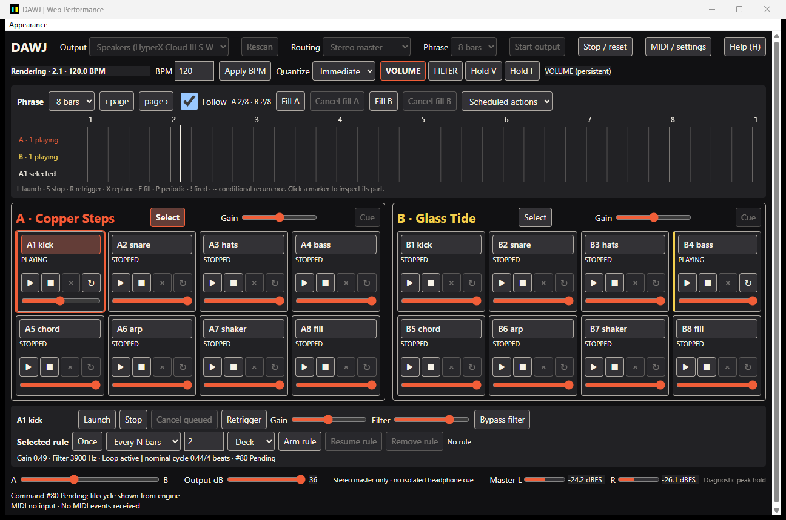

# DAWJ

DAWJ is a standalone live-composition and DJ performance instrument written in
Rust, licensed under GPL-3.0-or-later. Instead of playing a fixed arrangement,
you perform its musical parts and mix the result between two decks.

The vision is to combine performable compositions and conventional DJ tracks in
one instrument. **The current alpha performs your own WAV-based compositions and saves local
two-deck sessions. Ordinary DJ-track playback remains planned.**



## Two decks, sixteen parts

Each deck has eight fixed-position parts: launch percussion, bass or melodic
layers independently, queue changes to a beat/bar/phrase, then shape and crossfade
the arrangement. Both decks stay visible. The repeating timeline shows musical
position and upcoming activity without becoming a DAW arrangement editor.

What works today:

- Create compositions, assign WAV sounds, edit loops, and save/reopen local JSON sessions.

- Real sample/loop/one-shot playback with quantized launch, stop, cancel and retrigger.
- Shared BPM/transport, periodic triggers and fills, and truthful queued/playing states.
- Part gain and filtering, deck gains, crossfader, output trim and master diagnostics.
- Keyboard performance controls, generic MIDI learn/profiles, pickup and Note/CC feedback.
- Tauri as the default alpha interface, with portable CSS skins, previews and recovery;
  a maintained `dawj-egui` fallback.

Stereo output is master-only. Independent logical cue needs four output channels;
physical headphone isolation and controller behavior require hardware validation.
WAV is supported; MP3, pattern editing and time stretching are not implemented.
There is no arbitrary plugin host, synth engine or song library.

## Build and run on Windows

Install Rust through Rustup, Visual Studio C++ Build Tools with the desktop C++
workload/Windows SDK, and Microsoft WebView2 Runtime. The repository pins Rust
1.93.0. From the repository root:

```powershell
cargo run --release --locked
# Egui fallback:
cargo run --release -p dawj-egui --locked
```

Start with **Session / sounds** to create a composition on each deck and assign
your WAV files. Save/reopen the jam with **Save As** / **Open**. Choose your intended
audio output and press **Start output**. **Supplied demo** is also available; no
controller or npm server is needed. See [your first local jam](docs/user-guide/local-sessions.md). Open **Help** for shortcuts and **MIDI / settings** for controllers
and skins. See the [performance guide](docs/user-guide/performance.md).

A broken skin can be reset through the native **Appearance > Restore default
interface** menu or **Ctrl+Alt+Shift+R**. `--safe-mode` ignores saved skin selection;
`--reset-skin` clears user skin state.

## Status and documentation

DAWJ is a development alpha, not certified for live shows. Windows is the main
development target; Linux native/audio/MIDI validation and public-release packaging
remain incomplete. [Windows alpha builds](docs/development/windows-alpha.md)
provide a repeatable local build/check procedure. The frontends share one Rust
control layer and existing audio engine. Latency, device recovery and hardware limits are documented rather than
implied by unit-test success.

- [Documentation](docs/README.md) and [vision/roadmap](docs/design/vision.md).
- [MIDI controllers](docs/user-guide/controllers.md) and [skin authoring](docs/skins/authoring.md).
- [Build, test and contribute](docs/development/README.md) and [alpha review](docs/development/alpha-cutover.md).
- [Architecture](docs/architecture/overview.md) and [latency findings](docs/M3_WEB4_1_LATENCY.md).

Focused fixes, reproducible bug reports and hardware test results are welcome.
Include your OS, audio/MIDI device, reproduction steps and relevant checks.
Original application code is [GPL-3.0-or-later](LICENSE); see [NOTICE](NOTICE) and
the [dependency/asset distribution review](docs/development/licensing.md).
