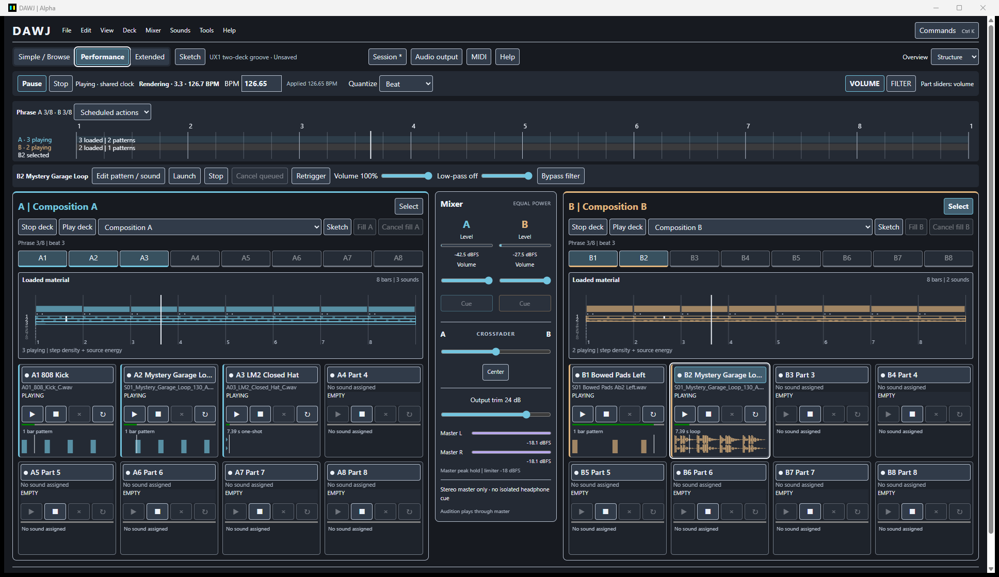
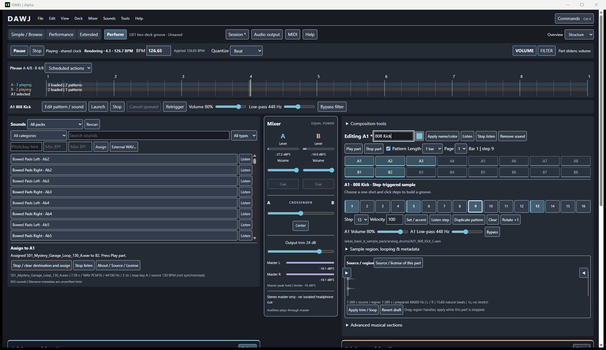
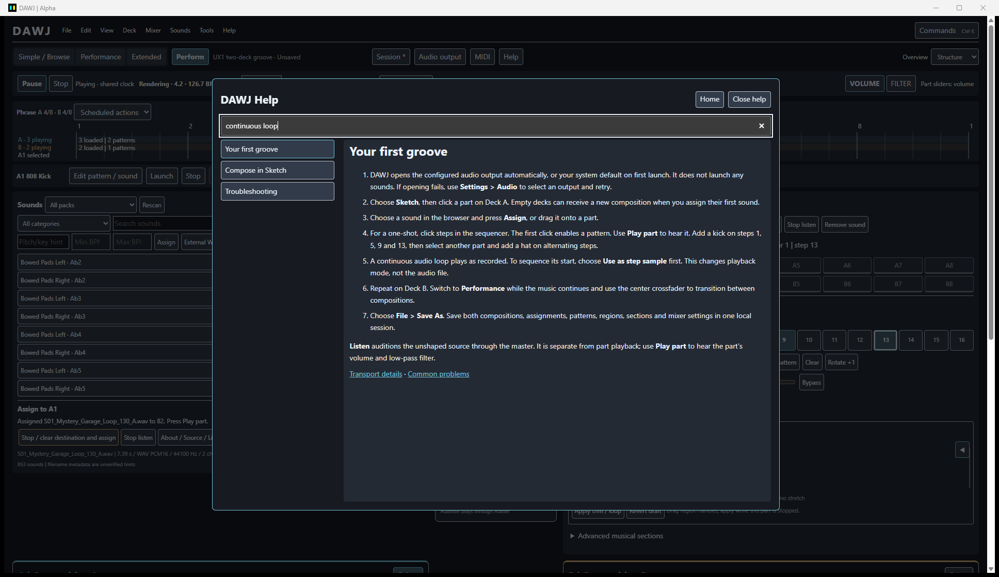
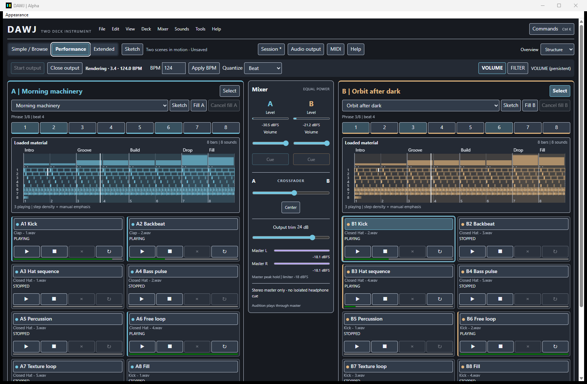
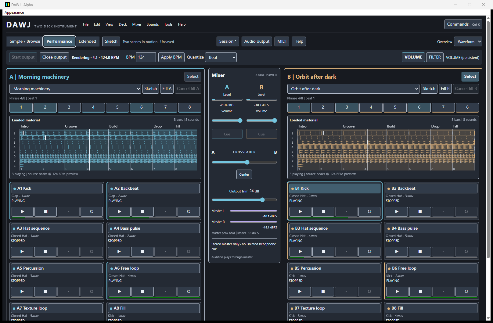

# DAWJ

DAWJ is a standalone live-composition and DJ performance instrument written in
Rust, licensed under GPL-3.0-or-later. Instead of playing a fixed arrangement,
you perform its musical parts and mix the result between two decks.

The vision is to combine performable compositions and conventional DJ tracks in
one instrument. **The current alpha performs your own WAV-based compositions and saves local
two-deck sessions. Ordinary DJ-track playback remains planned.**



*Two original compositions, part thumbnails and the shared musical timeline in Tauri.*

## Two decks, sixteen parts

Each deck has eight fixed-position parts: launch percussion, bass or melodic
layers independently, queue changes to a beat/bar/phrase, then shape and crossfade
the arrangement. Both decks stay visible. The repeating timeline shows musical
position and upcoming activity without becoming a DAW arrangement editor.

What works today:

- Author independent compositions on A/B, browse 853 factory samples, audition and drag sounds onto parts.
- Inspect original source/license records and use graphical, nondestructive trimming.
- Use automatic audio initialization, shared Play/Pause/Stop and independent deck launch/stop.
- Program real 16-step patterns with velocity/accent, 1/2/4-bar loops and four stored variations.
- Switch Simple / Browse, Performance, Extended and Sketch views while audio continues.
- See stopped and playing material in Structure, Waveform or Hybrid overviews with real source peaks.
- Add optional manual Intro/Build/Drop/custom sections in advanced Sketch controls.
- Read searchable offline help built directly from repository Markdown.
- Mix from a central strip with deck volumes, real deck meters, crossfader and cue routing.
- Save/reopen both compositions, patterns, sound references and mixer settings as local JSON sessions.

- Real sample/loop/one-shot playback with quantized launch, stop, cancel and retrigger.
- Shared BPM/transport, periodic triggers and fills, and truthful queued/playing states.
- Part gain and filtering, deck gains, crossfader, output trim and master diagnostics.
- Keyboard performance controls, generic MIDI learn/profiles, pickup and Note/CC feedback.
- Tauri as the default alpha interface, with portable CSS skins, previews and recovery;
  a maintained `dawj-egui` fallback.

Stereo output is master-only. Independent logical cue needs four output channels;
physical headphone isolation and controller behavior require hardware validation.
WAV is supported; MP3 and time stretching are not implemented. Deck EQ is deferred;
part gain and low-pass filters have real DSP support.
There is no arbitrary plugin host, synth engine or song library.

## Screenshots

Actual Tauri captures using two original compositions and the expanded factory library.

| Sketch | Offline help |
| --- | --- |
| [](docs/images/ux1-sketch.png) | [](docs/images/ux1-help.png) |
| Browse, assign and program a groove beside the mixer. | First-groove instructions and searchable local documentation. |

Inspect [sample provenance and licenses](docs/images/ux1-source.png) without leaving the instrument.
Earlier Jam4 captures show the available overview styles:

| Structure | Waveform |
| --- | --- |
| [](docs/images/jam4-structure.png) | [](docs/images/jam4-waveform.png) |
| Section labels, rhythmic density and pattern accents. | Actual stereo sample peaks, transients and loop repetitions. |

Material stays visible [before playback](docs/images/jam4-structure-stopped.png).
The current interface targets modern desktops, with a 1600 × 900 default and a
usable 1280 × 800 compact layout.
See the [musical overview guide](docs/user-guide/musical-overview.md) for full-size captures and editing instructions.

## Build and run on Windows

Install Rust through Rustup, Visual Studio C++ Build Tools with the desktop C++
workload/Windows SDK, and Microsoft WebView2 Runtime. The repository pins Rust
1.93.0. From the repository root:

```powershell
cargo run --release --locked
# Egui fallback:
cargo run --release -p dawj-egui --locked
```

Choose **Sketch** on either deck, create a composition, select a part, then
browse, listen, assign a sound and program its steps. Repeat on the other deck.
DAWJ initializes the configured or system-default output without launching sounds.
Use **Audio output** to recover or change devices. **Play part** or a manual launch
starts the groove; global **Play/Pause/Stop** controls musical time independently
of the device. Switch to **Performance** and mix both decks from the center. **File > Save As** saves your jam. See [your first local jam](docs/user-guide/local-sessions.md)
and the [performance guide](docs/user-guide/performance.md). See [musical overviews](docs/user-guide/musical-overview.md)
for visualization styles, source-time limits and musical sections.

**Ctrl+K** searches commands. **Tools** contains MIDI, audio and skin settings.
No controller or npm server is required. The explicit **Supplied demo** remains
available through Session. **Help** opens the [offline guide](docs/help/index.md).
Factory packs retain their [original source records and licenses](docs/development/factory-library.md) and are discovered under
`resources/samples/<pack-name>/`; externally assigned WAV files also work.

A broken skin can be reset through **Restore default interface** in Audio settings
or **Ctrl+Alt+Shift+R**. The native recovery menu stays registered without a visible
menu bar. `--safe-mode` ignores saved skin selection;
`--reset-skin` clears user skin state.

## Status and documentation

DAWJ is a development alpha, not certified for live shows. Windows is the main
development target; Linux native/audio/MIDI validation and public-release packaging
remain incomplete. [Windows alpha builds](docs/development/windows-alpha.md)
provide a repeatable local build/check procedure. The frontends share one Rust
control layer and existing audio engine. Latency, device recovery and hardware limits are documented rather than
implied by unit-test success.

- [Documentation](docs/README.md) and [vision/roadmap](docs/design/vision.md).
- [MIDI controllers](docs/user-guide/controllers.md) and [skin authoring](docs/skins/authoring.md).
- [Build, test and contribute](docs/development/README.md) and [alpha review](docs/development/alpha-cutover.md).
- [Architecture](docs/architecture/overview.md) and [latency findings](docs/M3_WEB4_1_LATENCY.md).

Focused fixes, reproducible bug reports and hardware test results are welcome.
Include your OS, audio/MIDI device, reproduction steps and relevant checks.
Original application code is [GPL-3.0-or-later](LICENSE); see [NOTICE](NOTICE) and
the [dependency/asset distribution review](docs/development/licensing.md).
