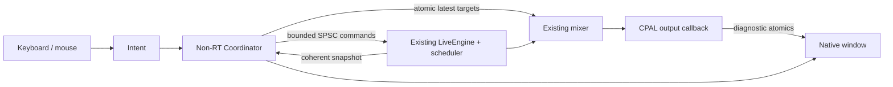

# M3.1–M3.2 native performance application

The `dawj` workspace package is a native egui/eframe window controlling the M2
`LiveEngine` through CPAL. Run `cargo run -p dawj --locked`. It loads Copper Steps
on A and Glass Tide on B when **Start demo output** is pressed. Opening the window
alone starts no audio. Both compositions use the original sixteen M2.7 procedural
WAV assets, decoded and prepared in memory; no external media paths are needed.

## Investigation and technology decision

README, the product/technical design, M1 architecture review, M2 architecture
review, M2.9 report, performance state contract, scheduler, Part reducer, DSP,
CPAL adapter and M2.7 demo/tests were inspected. `docs/M0_ARCHITECTURE.md` and
the README's `docs/source/` references are absent in this checkout. No replacement
M0 architecture document was invented. The actual M0 timebase/offline scheduler
and later reviews supplied the available architecture evidence.

M2.9's snapshot implementation and terminal-admission hardening are present.
The GUI does not reconstruct lifecycle from the old independent diagnostic
atomics. There was no established GUI dependency. Eframe **0.31.1**, egui 0.31.1,
and Glow/OpenGL were selected for the repository's pinned Rust 1.85.1 toolchain;
eframe declares Rust 1.81. Newer framework releases were unnecessary for this
slice. Default eframe features are disabled: enable only default fonts, Glow,
X11 and Wayland. No WGPU renderer, persistence, browser/server or audio framework
was added. Cargo metadata can still include optional packages beyond the compiled
Windows binary. Linux is structurally supported through CPAL and X11/Wayland,
but was not built or tested here; ALSA and graphics development packages are
required there.

Framework usage was checked against the [pinned eframe documentation](https://docs.rs/eframe/0.31.1/eframe/).
See the [dependency policy](GPL_COMPATABILITY_AND_RELEASE_POLICY.md) for exact
transitive versions, selected licenses and separately licensed font assets.

## Ownership and data paths

- `performance-app/src/lib.rs`: framework-independent focus, modes, command
  mapping, projection and a single control owner. `Intent` is the small common
  entry point for UI gestures and future MIDI mapping.
- `performance-app/src/window.rs`: rendering, centralized bindings, device
  selection, stream lifecycle and visible errors. It requests refresh every
  33 ms; input may request extra frames. It never schedules music from frame time.
- `audio-backend/src/demo.rs`: extracted unchanged M2.7 asset generation and
  engine preparation. The original performance CLI/test adapter now uses it too.
- The callback exclusively owns scheduler, PCM cursors, filter state and mixer
  DSP. Preparation, formatting, receipt allocation, window rendering and stream
  destruction stay outside it. The GUI never obtains mutable DSP structures.

Preparation and stream opening happen on the window thread before playback;
they can briefly stall the window. No background loader or graph swap is needed
for the fixed demo. Device stop/drop also runs there and may depend on driver
teardown latency. This is separate from realtime callback work.

## Truth, command bounds and failure behavior

One `performance_state()` attempt per UI update retains the previous coherent
snapshot if publication overlaps the read. Lifecycle, active/pending IDs,
pending deadline and per-part accepted parameters come exclusively from that
snapshot. Queued start has no active source. Pending stop/retrigger/replacement
still displays the playing source. Short release tails do not become Playing.
The main position and deck phrase positions use scheduler ticks, with 960 PPQ,
four beats/bar and the demo's eight-bar phrases.

M3 adds current `bpm: Option<f64>` to the existing coherent snapshot, increasing
its fixed payload from 166 to 167 words. The scheduler queries its existing tempo
map using rounded sample boundaries. Installing future tempo intent does not
change current BPM early. This is an explicit documented extension of M2.9;
the publication algorithm and original lifecycle semantics remain intact.

The audio command queue remains 32 entries. The coordinator holds at most 32
receipts and at most one unacknowledged parameter update per slot. It does not
retry rejected commands or store an unbounded backlog. Additional input is
explicitly rejected until audio consumes it; a subsequent gesture uses actual
accepted parameters. This is sufficient for ordinary UI gestures. M3.3 needs
bounded latest-value coalescing and admission priority before high-rate MIDI.

Admission feedback says submitted/awaiting engine. Tickets may later report
Queued, Applied, Rejected, Cancelled, Superseded, Expired or Closed. Expired is
unknown receipt history, never an invented success. The lifecycle remains the
snapshot's truth in all cases. Hover a slot title for its latest receipt; the
footer shows the latest command and any rejection. Cancel uses the pending ID
from the snapshot, so stale cancellation can reject without cancelling newer
intent. Mode and focus changes submit no audio command.

Deck gains, crossfader and cue use the existing latest-value `MixerControl`
path. Displayed mixer values are the coordinator's accepted control targets,
not sample-timed acknowledgments. Engine smoothing handles all parameter DSP.
Master peaks are explicitly lifetime-held post-limiter peaks, not an animated
instantaneous meter. Only the existing nonresonant cutoff is exposed.

After a user loopback/listening report exposed near-inaudible output, the GUI
demo now starts with +36 dB pre-limiter output trim, adjustable through Output dB.
The engine smooths trim over 20 ms on both logical buses. Both existing 0.125
output ceilings remain enforced; ordinary backend/CLI defaults remain 0 dB trim.
The small mixer ramp now reconstructs its remaining distance rather than
accumulating floating-point error into an oversized final correction.

If no publication advances for one second, the last display is marked stale and
audio controls disable. This wall-clock timeout only gates availability; it does
not decide musical boundaries. Closed/Failed also disables submission promptly.
The callback monitor's failure flag triggers terminal stream teardown and a
visible recovery instruction. CPAL currently supplies no retained detailed
runtime error cause, so the UI reports stream/engine failure without inventing it.

## Output and shutdown

Select an enumerated device explicitly, then start at 48 kHz, two or four
channels, with the first supported f32/i16/i32/u8 encoding and default buffer.
Unsupported configurations fail visibly; there is no silent output fallback.
Rescan is available while output is closed. Device names/ordinals are rechecked
before opening; an endpoint replacement with the same name remains an existing
CPAL discovery limitation.

Stereo maps master to 1/2 and disables cue. Four channels map master to 1/2 and
logical cue to 3/4. The window always says physical isolation is unverified;
separate stream channels do not establish headphone jack privacy. There is no
shared-stereo cue simulation. Startup/preparation errors remain in the window.

**Stop output** is terminal, not pause. Window destruction uses the same owner
teardown. The CPAL lifecycle flag closes engine admission and unresolved tickets,
while the coordinator gates its own controls. Start constructs a new engine,
transport domain, stopped slots and default controls. The last closed snapshot
is retained until then. For musical fades use quantized part Stop; terminal
output stop retains the backend's immediate gate and is not a click-free fade.

## Layout and test boundaries

Two decks remain visible with eight slots each in a fixed 2×4 grid per deck.
Selection, lifecycle words and pending boundaries supplement the deck/state
colors. Deck gains and cue sit above each grid. Modes, selected-part shaping,
quantization, crossfader and output diagnostics remain outside it. Dark theme is
explicit, including under a light Windows system theme. Help is a floating panel.
Text/numeric entry suppresses performance shortcuts; ordinary button focus does
not. Minimum viewport is 1100×740 logical points; default is 1280×820. Smaller
effective desktops or very high scaling may require a lower desktop scale.

Integration tests render the real engine offline and test the coordinator against
its actual snapshots, including all sixteen parts, cancellation, retrigger,
parameter reconciliation, tempo boundaries and shutdown. Egui headless tests
verify keyboard/text focus and that sixteen pending-state cards fit both viewport
sizes. Those tests do not establish hardware output, listening quality, private
cue, accessibility completeness or stage usability. See the implementation report
for the separate Windows smoke evidence and remaining acceptance gates.

## M3.3–M3.4 extension

`controls.rs` now provides source-tagged semantic dispatch and addressed part
actions. GUI, keyboard and MIDI share the coordinator; controller messages never
obtain `LiveControl`. `midi/` contains normalization, bounded input bridging,
validated profile persistence, pickup/mode routing, snapshot-driven feedback and
a worker owning midir connections. `window/midi_settings.rs` is rendering and
settings orchestration. No audio-thread I/O, locks, serialization or device work
was introduced. The temporary-mode stack holds at most sixteen source/token
records, and parameter coalescing has sixteen slots, four admissions per GUI
update and round-robin fairness. This supersedes the earlier M3.3 coordinator
work item above. Detailed bounds, lifecycle, configuration and hardware limits
are in [M3_HANDS_ON_CONTROLS.md](M3_HANDS_ON_CONTROLS.md).
