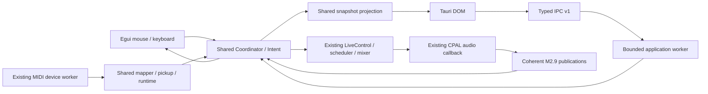

# M3.Web1: shared frontend architecture

Implemented on Windows x64, 2026-10-30. Egui remains the default application.
Tauri is a parallel migration frontend. Its working experimental DOM, themes
and engine integration were reused; no DSP or scheduling system was replaced.

## Run

```powershell
cargo run -p dawj --locked
cargo run -p dawj-tauri --locked
```

The workspace intentionally pins **Rust 1.93.0**, including rustfmt/Clippy, for
both applications. All packages declare Rust 1.93 and share the root lockfile.
The evaluated Tauri graph cannot build on the former 1.85.1 toolchain. Tauri
2.12.5 and tauri-build 2.7.4 remain exactly pinned. This toolchain/lockfile pair
was tested across the whole workspace.

Windows requires MSVC build tools/Windows SDK; Tauri also needs WebView2. No npm
setup, Node application runtime, development web server or Tauri CLI is needed.
Node is used only for frontend tests. Choose an output and explicitly start it.
Both frontends load the existing Copper Steps / Glass Tide resident demo, with
existing makeup gain, smoothing and limiters.

These are two executable choices using common code. Separate processes own
independent engine sessions, not interprocess access to a single stream. Sharing
the same audio/MIDI device simultaneously depends on OS/driver support.

The original experiment remains on `experiment/tauri2-performance` at `d3aade5`.
Its files were promoted to `crates/tauri-app`; its temporary nested workspace and
ad hoc thread-local JSON handler were replaced. The earlier
[evaluation](TAURI_FRONTEND_EVALUATION.md) remains a historical report.

## Shared code and ownership

`crates/performance-core` (`dawj-core`) owns the moved Coordinator, semantic Intent
dispatch, selection, quantization, persistent/held modes, MIDI mapping/pickup,
device worker, profile persistence, LED feedback and pure timeline projection.
Existing integration tests moved with these implementations. `dawj` keeps a small
compatibility re-export, preserving GUI and synthetic MIDI example imports.

The core dependency tree has **no egui, eframe, Tauri or WebView dependency**.
Authoritative engine state types are re-exported as `dawj_core::performance_state`.
Both frontends use the same Coordinator and lifecycle projection. Shared `output`
setup handles discovery, configuration selection, ordinal/name revalidation,
demo preparation and CPAL opening. The existing 48 kHz supported sample encodings,
2/4-channel policy and validated cue routing are preserved.

Shared `midi::runtime` implements bounded event draining, epoch/drop handling,
parameter flushing and 50 ms LED cadence. Both frontends call it. Startup profile
loading and stopped-LED shutdown are shared too. Tauri loads the same saved MIDI
profile and services it independently of WebView refresh. Replacing a profile
drains old queued events before using its new mappings.



Egui retains its direct control-thread ownership and complete UI. Tauri uses the
frontend-neutral Service/Client adapter. Neither frontend duplicates launch,
cancel, smoothing, cue or scheduling rules.

`Service::spawn` returns a lightweight Client immediately. The named
`dawj-control` thread constructs, operates and destroys CPAL. Handles never cross
threads or require unsafe Send/Sync wrappers. Asset preparation/decoding, audio
enumeration, stream operations and profile file I/O run there. The existing MIDI
worker separately owns its driver handles and sends.

Tauri commands try admission and asynchronously wait through `spawn_blocking`.
There is no `run_on_main_thread` device/engine work. A slow startup can delay other
control replies on this single worker while WebView rendering remains responsive.
The worker polls Coordinator and MIDI between commands and after an 8 ms idle
timeout. That timer services observation/input; engine frames and musical
boundaries remain the sole scheduling authority.

Shutdown closes admission through an out-of-band atomic flag, even with a full
queue. Queued callers wake as Closed and their permits release. The owner closes
Coordinator admission, stops/drops CPAL, sends stopped LEDs and joins MIDI.
Joins occur during native exit, outside audio. A driver operation already in
progress may delay shutdown; OS driver-call duration is not claimed to be bounded.

## IPC v1

`dawj_core::ipc` is the authoritative typed Rust contract. Requests contain
`version: 1`, a `u32` correlation ID and a tagged Command. Replies echo the ID and
supported version, with `result.Ok` containing a tagged Response or `result.Err`
containing an error code/message. Unsupported versions reject before admission.
Unknown request/action fields reject, including unknown fields on empty commands.
Malformed JSON rejects at Tauri argument decoding before dispatch.

```json
{"version":1,"id":42,"command":{"kind":"perform","source":"Gui","action":{"kind":"launch","deck":0,"slot":0}}}
```

The action adapter converts once into existing Intent, preserving input source.
Typed commands cover output discovery/start/stop, snapshots, selection,
launch/stop/cancel/retrigger, gain/filter, mixer/cue, tempo, quantization,
persistent/held modes, source release and periodic rules. MIDI commands expose
profile get/replace/load/save, connection/rescan and learn. Acceptance is not
audio execution: delayed engine outcomes remain separate receipt feedback.

Admission caps **32 queued/in-progress jobs**, including stalled initialization.
The channel uses `try_send`; each reply channel holds one value. Work-owned
permits release after success/failure, receiver drop or shutdown. Existing audio
queue and 32-receipt bounds remain intact. Fault codes are Busy, UnsupportedVersion,
Invalid, Unavailable, Failed and Closed. Stream failure rejects further performance
actions until output restarts. Browser admission also caps 32; crossfader input
keeps one latest unsent target and one invocation in flight.

Projection copies one retained engine publication. Generation, frame, beat, BPM,
sample rate, both deck clocks and all sixteen parts come from that copy. Part
records preserve typed lifecycle, active/pending identities, command IDs and
boundaries, source position, accepted parameters, releases, one-shot flags,
nominal length and rule definitions/deadlines/counters. Selection, accepted mixer
targets/cues, receipt feedback, peaks and MIDI status are separate control or
diagnostic fields, not one audio-generation acknowledgement. Offline snapshots
do not manufacture playing parts.

The web `protocol.mjs` wrapper checks version and correlation, then unwraps replies.
Rust and Node both check `ipc-v1.examples.json`. Rust types are the contract source;
automatic TypeScript/schema generation is still a gap. Breaking wire changes need
a version bump and matching bundled frontend. No new skin system was introduced.

## Feature parity checklist

| Capability | Shared core | Egui | Tauri surface |
| --- | --- | --- | --- |
| Two decks, sixteen live states, launch/stop | Complete | Exposed | Exposed |
| Mixer smoothing and crossfader | Existing engine | Exposed | Crossfader exposed |
| Output formats and validated 4-channel cue | Shared setup | Exposed | IPC supports cue; selector remains stereo |
| Selection, cancel/retrigger, quantization | Intent + typed IPC | Exposed | UI pending |
| VOLUME/FILTER, held modes, release | Shared dispatch | Exposed | UI/keyboard pending |
| Part/deck gain, cutoff, trim, tempo | Shared dispatch | Exposed | UI pending |
| MIDI mapping, pickup, learn, profiles, LEDs | Shared runtime + IPC | Complete settings | Saved-profile runtime; settings UI pending |
| M3.5 timeline and rule actions | Shared state/projection + IPC | Exposed | Timeline UI pending |
| CSS presets/accent/local overrides | Existing experiment retained | Native styling | Exposed |

Future WebView keyboard/momentary controls must declare input source, release on
focus loss and preserve text-entry handling. Those UI controls are not complete
here. Egui remains the default until parity and performance checks pass.

## Verification

Before changes, all **119** original workspace tests passed. After extraction:

- Formatting, workspace check and Clippy with warnings denied passed on 1.93.0.
- All **125 workspace tests** passed, including offline, timing, concurrent
  snapshots, realtime, MIDI/pickup, timeline and native GUI tests.
- Seven Node tests and application JavaScript syntax check passed.
- Windows dependency inventory gate passed: **347 external resolved packages**,
  including optional nodes; this is not a compiled-package count.
- Core dependency-tree inspection found no frontend framework.
- Both Windows GUI/audio smoke tests passed with actual CPAL output.

```powershell
cargo fmt --all -- --check
cargo check --workspace --locked --offline
cargo clippy --workspace --all-targets --locked --offline -- -D warnings
cargo test --workspace --locked --offline
node --test crates/tauri-app/web/model.test.mjs crates/tauri-app/web/protocol.test.mjs
node --check crates/tauri-app/web/app.js
python scripts/audio_dependencies.py
cargo build -p dawj -p dawj-tauri --locked
powershell -NoProfile -ExecutionPolicy Bypass -File scripts/smoke_frontends.ps1
```

New tests cover strict/versioned wire fixtures, all sixteen IPC action targets,
pending/cancel coherence, modes/rules/invalid inputs, worker-thread isolation,
capacity exhaustion, full-queue shutdown and caller-disconnect permit cleanup.
New Clippy's mechanical let-chain/is-multiple-of fixes preserve backend conditions;
no DSP or scheduler algorithm changed.

Tauri smoke observed queued -> active A1/B4, nonzero stereo peaks (~0.0565/0.0452),
crossfader admission, invalid-command rejection, independent A1 stop and output
shutdown. The final debug snapshot IPC run (100 calls) measured about **1.6 ms
median / 3.1 ms p95 / 5.4 ms max**; an earlier run measured 1.3/1.8/2.4 ms,
illustrating runtime variability. Response-to-active wait was ~490 ms at beat quantization and
120 BPM. These are not audible-latency measurements. Egui smoke passed with actual
audio, shaping, queued actions, rules and captured window output. Logs are in
`target/web1-*.log`; egui capture is `target/m3-native-capture.png`.

Human listening/visual usability, physical MIDI/LED hardware, private cue routing,
Linux builds, installers, device-loss recovery and long soaks were not verified.
WebView2 still logs teardown class-unregister error 1412 after successful native
metrics and exit; triage before release. No silent-success simulation or automatic
device recovery was added.

## Release work and remaining gaps

Application code remains GPL-3.0-or-later. The exact Windows inventory and scoped
MPL-2.0 screening exceptions were updated; see the
[release policy](GPL_COMPATABILITY_AND_RELEASE_POLICY.md). Tauri selects
Apache-2.0. Retain notices and corresponding source, including MPL-covered files;
existing separately licensed egui fonts are unchanged. WebView2 is a prerequisite,
not redistributed. No advisory scan or full redistribution clearance is claimed.

Remaining work: UI parity through this contract, generated frontend types,
portable theme files/reset recovery, controller/focus failure tests, release-load
timing comparisons and Windows/Linux packaging. The complete egui interface stays
available during that migration.
