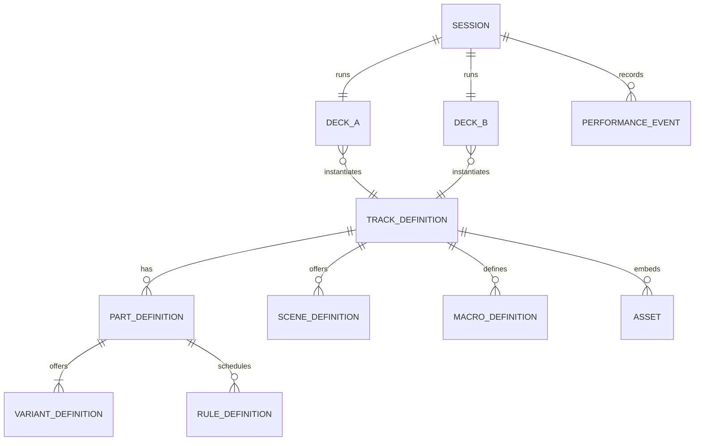
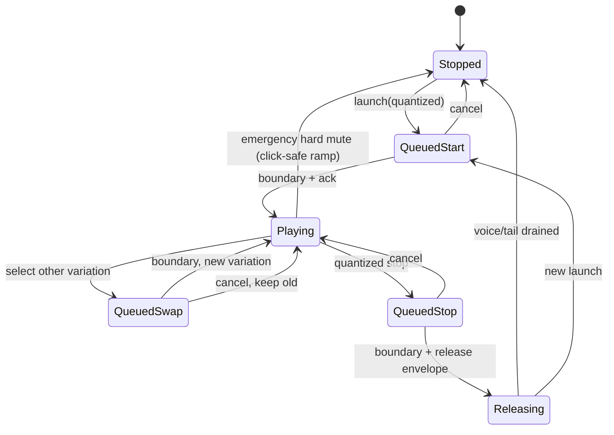
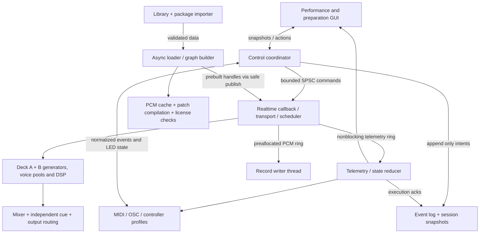

# Two-Deck Live Composition Instrument
## Product Design Document and Technical Architecture Specification

**Working codename:** DUET (placeholder, not a proposed brand)  
**Document:** PDD / TAS v0.1, design baseline  
**Prepared:** 28 October 2026  
**Status:** Exploratory specification, not implementation approval  
**Audience:** Founder, audio/DSP engineering, interface design, producer-testers  
**Decision convention:** **[C]** founder-confirmed direction · **[P]** proposed design · **[O]** unresolved/experiment-dependent · **[X]** explicitly excluded from initial release.  
**Evidence convention:** External product/framework claims carry numbered references in §20. All unreferenced performance targets, timings, workflows, and algorithms are **design proposals**, not established user research findings.

> **Product thesis.** A DJ should be able to load a musical composition as an *instrument*, improvise its arrangement and sound, then mix it into another composition, without managing a full DAW session. The unit of selection is a producer-authored performable track; the unit of action is a musical part; the performance gesture is launch, mutate, shape, cue, and transition.

---

# 1. Executive recommendation and decision summary

**Recommendation:** Build a desktop standalone **two-deck composition player**, with a small but rigorous preparation tool and a deliberately constrained performance surface. Use a single authoritative musical clock, eight *part slots* per deck initially, preloaded instrument/sampler assets, sample-accurate commands, independent cue routing, deterministic recorded events, and a configurable MIDI controller map. **Do not initially build a DAW, plugin host, stem separator, sophisticated key matcher, generalized generative music system, or universal mastering engine.**

**Provisional stack choice [P]:** Rust application core + CPAL audio I/O + a purpose-built bounded DSP/transport graph + a GPU-rendered native desktop GUI (initial prototype: egui/eframe or equivalent). C++ DSP libraries can enter behind narrow C ABI shims **only after licenses and realtime behavior are checked**. This choice aligns strongly typed state, portable data formats, and deterministic scheduling with a small-team custom-product scope. **Gate this choice on two early spikes:** stable independent four-/six-channel audio output and an interactive 16-part UI under continuous audio. If either spike is unexpectedly costly, switch the **entire desktop/audio shell** to C++/JUCE before implementing the package ecosystem. JUCE may shorten device/GUI development, but is not automatically lower-risk commercially; see §13. This is a *preference*, not a definitive performance benchmark.

**Biggest risks, in order:** (1) no measurable live-performance advantage over Ableton/Bitwig/Force; (2) authoring a composition takes longer than the improvisational payoff justifies; (3) confusing persistent layer state, pending launches, and encoder pickup; (4) loudness/bass surprises during a transition; (5) gapless background loading plus cue routing; (6) poor audio stretching outside modest tempo shifts; (7) modes that prevent muscle memory; (8) cross-platform driver and MIDI device variance.

**Fundamental design correction:** An eight-bar timeline is a **contextual musical lens**, not the primary global object. The persistent primary surface should show **what each deck is doing now and what will happen next**. Editing an 8-bar trigger grid while mixing two 8-part compositions is too much simultaneous visual/physical work. Place a detailed timeline only on the currently focused deck/part; keep both deck status matrices permanently visible.

**Validation criterion [C]:** a performer can improvise a coherent **15-minute uninterrupted two-composition set**, with cueing, parts, variations, effects and a transition, without opening a DAW editor. **Additional proposed decision gate:** at least four of six independent producer/DJ testers prefer the speed/confidence of this workflow over a matched, preconfigured Ableton Session View exercise *for that narrow task*. Sample size is exploratory, not statistical proof.

## 1.1 Scope and evidence register

| ID | Classification | Statement | Consequence |
|---|---|---|---|
| R-01 | [C] | Standalone app, not DAW wrapper/plugin | Own transport, audio, state, UI |
| R-02 | [C] | Two simultaneously loadable layered decks | Explicit deck architecture and mixer |
| R-03 | [C] | Track = prepared palette/composition; part = independently performed layer | Portable track format; prep workflow |
| R-04 | [C] | Shared BPM/clock; Camelot-first key handling | No enforced master key; musical phase rules |
| R-05 | [C] | Multichannel output and headphone cue are essential | Minimum I/O compatibility gate |
| R-06 | [C] | Live stability and sound quality over optional features | No runtime allocation, safety mixer, diagnostics |
| R-07 | [C] | MIDI-mapped software first, dedicated hardware optional | Hardware-agnostic command layer |
| R-08 | [C] | Distinguish preparation from performance | Strict editor/performance boundary |
| R-09 | [P] | Eight part slots per deck; one active variation per part | Clear mapping; polyphony controlled by instruments |
| R-10 | [P] | One global 4/4 transport plus deck phrase epochs | Deterministic quantization/launches |
| R-11 | [P] | Preload first seconds of samples; preload synth graphs | Safe deck loading and swap |
| R-12 | [P] | Prep warnings, bass-role contracts, runtime limiter | Preventative safety, not automastering |
| R-13 | [P] | Rust-first; conditionally pivot to JUCE | Time-box architecture spike |
| R-14 | [P] | Stereo PCM master recording for MVP; event-log recording early internal | Audible artifact plus deterministic diagnostics |
| R-15 | [O] | Exactly eight versus 6/12/16 parts; filter/timeline layout | Test with stage users |
| R-16 | [O] | Whether scenes, generation, XY, stem imports ship in v1 | Feature probes, not assumptions |
| R-17 | [X] | Arbitrary VST hosting, DAW arrangement editing, AI audio generation | Avoid unbounded graph and licensing burden |

---

# 2. Competitive landscape and defensible differentiation

**Important framing:** Nearly every individual capability exists. Claims of invention should be limited to a tested interaction model and format/convention, not to “clip launching with two decks.” The most direct threat is a well-designed Ableton Live/Bitwig set plus MIDI scripts, not simply conventional DJ software.

| Product | Established relevant capabilities | Critical gap *relative to proposed experience* | Design lesson |
|---|---|---|---|
| **Traktor Remix Decks** | Remix Sets, four sample columns, up to 64 samples, synced DJ-deck behavior, MIDI control [R01, R02] | Primarily sample/loop material rather than a general packaged synth + MIDI + constrained composition model | **Closest DJ interaction ancestor.** Need convincing reasons beyond “more sample cells.” |
| **Ableton Live Session View / Push** | Quantized clips, scenes, follow actions, MIDI and instruments, improvisation recording [R03, R04] | Native organization is arbitrary project/track grid; preparing a two-deck DJ-like interaction takes design and controller work | Build speed/confidence, not a weaker Ableton clone. |
| **Bitwig Clip Launcher** | Scene launches, ALT launch modes, next actions, deterministic seeds on captured random clips [R05, R06] | Open-ended DAW interface and project graph | Explicit seeding/replay already exists; match practical quality. |
| **Akai Force** | Standalone clip matrix, synths, effects, XY/touch, arranger, sequencing and performance pads; firmware 3.9 adds tempo automation and stems [R07] | Broad workstation with a complex integrated workflow | Do not claim “two decks of performance synthesis” is categorically unprecedented. |
| **Novation Circuit Tracks** | Screen-free patterns/scenes, mutation, eight macro encoders, two synths/four sample drums/two MIDI tracks [R08] | Groovebox set is not principally a DJ library with cueable incoming compositions | Borrow predictability, muscle memory, minimal display dependency. |
| **Mixvibes Remixlive** | Synced loop grids, sequencer, song mode, project continuity, BPM/key matching, Ableton Link [R09] | Emphasizes sample-pack/live loop workflow more than portable prepared synth-track + cueing model | Closest mobile sample-first experience; avoid reinventing it unchanged. |
| **Loopy Pro** | Highly configurable canvas; audio and MIDI loops, one-shots and widgets [R10] | User must build own interaction surface, not standardized two-deck portable composition format | A fully configurable UI is not automatically easier onstage. |
| **Endlesss** | Multiplayer loop station and iterative collaborative riffs [R11] | Jam/community creation instead of curated dual-deck DJ performance | Community and derivative track sharing are future opportunities. |
| **Korg Kaossilator Pro+** | XY sound performance, scales, four stackable loop banks [R12] | Limited composition structure / cueable two-track transitions | Preserve gestural immediacy, not hardware replication. |
| **Koala Sampler / MPC / Maschine** | Sampling, pads, sequencing, performance FX; widely relevant adjacency | Different emphases, often more authoring/sampling than DJ library transitions | Validate against *actual configured sets*, not marketing feature counts. |

## 2.1 Novelty assessment

**Established:** layered loops, synth sequences, scenes, part mutes, pattern variation, per-layer effects, quantized triggering, MIDI mapping, random mutation, auto key hints, two-channel crossfading, custom widget layouts, sample-pack exchange.

**Potential differentiation, contingent on testing:**

1. **Performable-track abstraction:** a composition becomes a redistributable, versioned, bounded-performance instrument with producer-defined safety and expressive semantics.
2. **Two-deck semantic contract:** the user browses and cues *whole prepared musical worlds*, retains DJ-style crossfade and monitoring, and recomposes each live without session engineering.
3. **Always-readable action state:** per-part NOW / NEXT / HELD information across both decks, with controller LEDs and screen never disagreeing.
4. **Preparation-grade compatibility/safety testing:** deterministic combination audits, bass-role constraints, voice/level budgets, macro calibration, all attached to the track artifact.
5. **Opinionated performance-mode interaction:** 16 fixed-address part slots and a small set of meaningfully constrained macros; muscle memory transfers between producer-made tracks.

**Defensibility hypothesis [O]:** the moat is the performance convention and a quality library of artist-authored tracks, not proprietary basic DSP. This creates a chicken-and-egg challenge: without compelling tracks the performance engine sounds like a toy; without performers artists will not author track packages.

## 2.2 Structured competitor bake-off

Prepare the **same two eight-part compositions** in Ableton Session View, Traktor Remix Decks (as far as feature-comparable), and the prototype. Give each participant 10 minutes of orientation, then measure: time to cue/transition, missed intended launches, eyes-on-screen fraction, physical actions for variant swap and fill, inability to recover from mistakes, peak anomalies, and subjective expressive control. Use equipment/knowledge counterbalancing; don't stack the experiment by underconfiguring competitors. A test that fails this comparison should trigger a product redefinition rather than incremental feature accumulation.

---

# 3. Users, jobs, and anti-goals

## 3.1 Primary personas [P]

- **Producing DJ:** creates patches/stems and performs evolving versions of their tracks. Wants continuity and expressive variation without backing-track playback.
- **Prepared-track DJ:** acquires authorized track packages, understands musical mixing and arrangement but does not edit synthesis internals. Wants dependable cue/mix and a short learning curve.
- **Live hardware performer:** uses a controller as instrument, often with one hand on sound shaping and the other on launching; cares about feedback and no hidden state.
- **Track author/distributor:** exports packages with ranges, mappings, musical metadata and licensing. Wants the resulting experience to sound intentionally composed, not easily broken.

## 3.2 Jobs-to-be-done

**Before performance:** “I can convert stems/MIDI/samples/synth patches into a playable track in under 30 minutes after initial familiarity” (target, not confirmed). **During performance:** “I can change the coming 8 bars with two gestures, keep bass coherent, cue the other deck, and transition confidently without losing my place.” **After:** “I can listen to a stereo recording, inspect what I did, and reproduce a good moment.”

**Anti-goals:** detailed note automation during a gig, unlimited instrument graphs, complete mastering, automatic DJ decisions, AI arrangement of copyrighted material, complex forced harmony, multiuser collaboration in initial MVP, mobile-first interface, one-click DAW set import with perfect fidelity.

---

# 4. Conceptual and persistence model

## 4.1 Domain entities

| Entity | Responsibility | Identity and lifespan |
|---|---|---|
| **TrackDefinition** | Immutable composition package, asset references, part definitions, patches, patterns, metadata and safe defaults | Versioned content hash; many DeckInstances |
| **PartDefinition** | Fixed performance role/slot; one sound engine + variants + control policies | Stable UUID inside track, display index 1–8 |
| **VariantDefinition** | One executable phrase/loop/pattern (or sequence specification) for a part | Stable UUID, references assets/instrument |
| **SceneDefinition** | Author-stored set of per-part intentions, optional macro defaults | Optional after MVP |
| **RuleDefinition** | Declarative conditions and periodic events (every N bars, once, probability) | Compiled non-RT into bounded schedule |
| **MacroDefinition** | Normalized control routed to bounded, author-tested targets | Runtime control 0…1 |
| **DeckInstance** | TrackDefinition + mutable state, phrase epoch, part machines, audio buses, cue | Runs until unloaded |
| **PartRuntime** | Armed/playing/stop state; active/pending variation; local phase | Per loaded deck |
| **Session** | Clock, deck assignment, A/B mixer, routing, recording, controller focus | One live performance |
| **PerformanceEvent** | Timestamped performer intent and applied outcome | Append-only session log |
| **PackageExport** | Portable artifact created in preparation with checked dependencies | Signed/hash-validated optional later |

**Terminology policy:** use *Track* for a composition package, *Part* for the eight independent stage channels, *Variation* for alternate MIDI/sample content within a part, and *Scene* for coordinated part states. Avoid UI collision with a DAW's “audio track.”

## 4.2 Invariants

1. Each deck has at most one loaded **TrackDefinition**, but can retain the previous deck audio tail while a replacement finishes loading only under a carefully specified tail policy; never silently replace while audible.
2. Each part has **at most one selected active variation**; its instrument may be polyphonic. Transition tails can coexist for a finite bounded time (two instances max) when a swap crossfades.
3. Deck A and B share a continuous beat timeline, tempo map, and transport playback state. They may have **distinct phrase epochs** and phrase lengths.
4. Queued performer actions are explicit objects with cancellation/replacement IDs, not anonymous callbacks.
5. Runtime DSP graphs are immutable between safe atomic graph swaps; no disk I/O or memory reclamation from the audio callback.
6. Cue output is independently mixed from designated pre-crossfader taps and never collapses into main without deliberate routing.
7. All stochastic decisions affecting notes/events consume named, recorded PRNG streams.
8. A track package is data, not arbitrary executable code or dynamically downloaded plugins.

## 4.3 Entity relations



---

# 5. Performance UX: information hierarchy and gestures

## 5.1 Persistent visual representation [P]

Use **two eight-row vertical part strips** with the same y positions and labels, flanking a central mixer/transport strip. Each part row has: identity (color + icon + role), active variation, state (“playing”, “queued”, “stopping”, “off”), immediate level indication, small progress/phrase marker, and a single visible pending action. Keep meters and controls readable at low display luminance. The selected deck gets a collapsible **8-bar phrase lens** below, defaulting to four bars visible on small screens with bar/page indication; do not double two full editing grids into the main view.

### Wireframe A: Performance, 1440×900 concept (not a pixel-locked spec)

```text
┌─────────────────────────────────────────────────────────────────────────────┐
│  LIBRARY  [track search]    BPM 140  4/4  008:3:2  Q BAR   REC ●   CPU 16%│
├──────────────────────────┬────────────────────┬───────────────────────────────┤
│ DECK A: IRON RAIN  8A    │     MIX / TIME     │ DECK B: MARROW  9A          │
│ 140 native | PLAYING     │  [A METER][B METER]│ 136 native | CUED / ARMED    │
│ KICK    [A1] ● play  ▂▇ │  A  -8dB   B -∞    │ KICK     [B1] ◌ queued     │
│ SNARE   [A2] ● play  ▃▆ │  ▓▓▓▓▓│□□□□□      │ SNARE    [B2] ○ off        │
│ HATS    [A3] ↻ var2  ▂▃ │  XFADE [A──────B]  │ HATS     [B3] ● play(cue)  │
│ BASS    [A4] ● play  ▃▆ │  HP cue A / B       │ BASS     [B4] ◌ queued     │
│ CHORDS  [A5] ○ off      │  EQ low / trim     │ CHORDS   [B5] ○ off        │
│ LEAD    [A6] ◌ next bar │  FILTER  EQ  LEVEL │ LEAD     [B6] ○ off        │
│ TEXTURE [A7] ● play     │  SHIFT = momentary │ TEXTURE  [B7] ● cue       │
│ FILL    [A8] ↻ every 8  │  PANIC / MASTER    │ FILL     [B8] ○ off        │
├──────────────────────────┴────────────────────┴───────────────────────────────┤
│ FOCUS A4 BASS   MODE PATTERN   V1 [selected]  V2  V3  V4    ◌ queued → 009│
│ BAR      1      2       3       4       5       6       7       8          │
│ KICK     ■      ■       ■       ■       ■       ■       ■       ■          │
│ FILL     ·      ·       ·       ·       ·       ·       ·       ◇          │
│ ACTIONS  RESTART  SWAP VAR  FILL ONCE  LOOP RULE   CANCEL QUEUED           │
├─────────────────────────────────────────────────────────────────────────────┤
│ SIGNAL OK  MAIN OUT 1-2  |  CUE OUT 5-6  |  LAT 5.3ms+DSP  |  SAFE METER     │
└─────────────────────────────────────────────────────────────────────────────┘
```

`●` playing, `○` stopped, `◌` pending, `↻` recurring rule, `◇` scheduled one-shot. **Never encode operational state by color alone.** Display a countdown “next bar in 0.6 s” on hover/selected item; blink/pulse hardware LED when queued, steady when active. Exact LED behavior is profile-specific.

### Wireframe B: Prep environment (not shown on stage)

```text
┌─ PACKAGE + ASSETS ──┬─ EIGHT PARTS / ROLES ─┬─ SELECTED PART ──────────────┐
│ Title / artwork     │ 1 KICK  sample kit    │ Engine: drum/sample          │
│ BPM / Camelot       │ 2 SNARE  pattern      │ Variations: basic / busy     │
│ Import WAV / MIDI   │ 3 HATS   pattern      │ 16-step editor / microtime   │
│ Sample analysis     │ 4 BASS   synth        │ Launch: next bar             │
│ Pack dependencies   │ 5 CHORDS loop        │ Stop: end bar / short tail   │
│ Export / validate   │ ...                   │ Filter bounds / macro map    │
├─────────────────────┴───────────────────────┴───────────────────────────────┤
│ PREVIEW  [all common layer combinations] [bass conflict test] [output meter]│
│ MACROS   density → A3 activity; tension → B4 resonance cap, A5 drive ...   │
│ WARNINGS  repeated sub stacking / loud peak / outside tempo corridor       │
└─────────────────────────────────────────────────────────────────────────────┘
```

## 5.2 Modes and controls

**Invariant across modes:** dedicated deck level/cue, crossfader, emergency main mute, part pad launching, transport/time, master meters, current A/B focus, and explicit cancel-pending action. A mode changes **the bank of eight encoders for the focused deck**, *not* pad launch meaning. This protects muscle memory. Bank labels are always visible on screen and emitted through controller feedback if supported.

| Mode | Each encoder 1–8 means | Detailed view | Behavioral protection |
|---|---|---|---|
| **LEVEL (default)** | Part gain (smoothed) | part meters | pickup or endless relative |
| **FILTER** | Per-part bipolar macro (LP ← neutral → HP) | cutoff and type | neutral detent, gain compensation bounded |
| **EQ** | Assignable per-part tone (not full 3-band EQ for each with only eight encoders) | tone curve | explicit label; full EQ in prep |
| **PATTERN** | Variation index or density, per author metadata | selected part notes/variation | guarded discrete steps; preview |
| **PERFORM** | Eight producer-authored expressivity macros/part targets | target ranges | always finite bounded values |

**Momentary mode** [P]: hold FILTER while manipulating knobs, release to return to latched mode. On latch/momentary transition, **endless encoders** preserve normalized state. For absolute knobs/faders use **soft takeover** with a visible mismatch/threshold: do not jump a live filter when the mode changes. Mode buttons must be mechanically distinct from panic/cue. On controller disconnect, no unintended state changes; retain playback and allow keyboard takeover.

**Cue/playback contract [P]:** Cue is a **routing state**, not a separate secret transport. For MVP, auditioning a part in headphones starts that part in the actual incoming deck. It stays phase-continuous when the crossfader later opens; cue does not silently rewind it. Set the incoming deck phrase epoch on its first musical launch (or explicitly reset it while muted). An isolated scratch-preview engine could audition a sample without modifying deck state later, but it is **not** part of the MVP. This avoids an invisible second arrangement and makes “what I cue is what the audience will hear” testable.

**Gesture vocabulary:** short press = launch/stop-toggle with quantization, double press = **not** a required primary gesture (ambiguous timing), shift+pad = preview/selection or cancel queued action (test interpretation), long press = momentary variation chooser (optional). Important launch and stop need separately accessible actions via touchscreen context or controller mode/shift. Avoid hidden destructive shortcuts.

## 5.3 User flows

**Load and audition incoming track:** library filter by BPM/Camelot → select target inactive deck → async load/progress → validate audio and ready badge → enable pre-fader deck cue → start desired parts in B while its main gain remains zero → listen in headphones without leaking to main → queue additional parts at compatible global boundaries → mix crossfader → safely unload outgoing deck only after tail drain and confirmation.

**Create 8-bar development:** play initial rhythm → queue bass start at next bar → select bass variant 2 (schedules replacement at next bar) → arm a fill once on eighth bar relative to deck epoch → manipulate tension macro during bars 5–8 → release macro or allow latched value → remove lead at phrase boundary. There must be clear screen/pad status for *both current and pending* states.

**Recover from a mistake:** if queued action is wrong, press same intended pad again *only if the configured action is “cancel pending”;* otherwise use visible CANCEL. If already fired: immediate unquantized part mute (safety) then re-queue correct variant. Recoverability is more important than clever toggling.

## 5.4 XY performance controller [P, post-MVP]

Two axes may be assigned to **bounded, mutually legible** macros (e.g. X: filter/tone, Y: send/density) in a track-defined performance pad. Do not give the same 2D location inconsistent hidden meanings between songs without a prominent mode/target legend. Evaluate spring return vs latch, gesture recording, multi-touch, pickup, and MIDI/OSC XY. A Kaossilator inspiration does not imply that the XY pad must be the primary sequencer interface.

---

# 6. Transport, phrase time, and action semantics

## 6.1 Time domains

The engine owns a monotonically increasing **absolute sample frame `F`**, sample rate `Fs`, and a piecewise-tempo **global musical beat position `G(F)`**, measured in quarter-note beats. Session transport may stop/resume; audio callback frame count remains monotonic. All quantized launch actions are stored as **musical beat targets**, not fixed wall-clock times, until translated to exact sample offsets shortly before execution.

- **Global beat**: authoritative for synchronization, bar launch quantization and external sync.
- **Deck phrase epoch `E_d`**: global beat at the deck's chosen downbeat; phrase relative position `P_d = (G − E_d) mod (4 × phraseBars_d)` in MVP 4/4.
- **Part musical phase**: local playing position, normally `(G − partStartBeat) mod partLengthBeats`; may use *legato phase* following deck epoch or retrigger phase resetting at launch.
- **Phrase length**: default eight bars for arrangement view; not a fixed max nor a mandate that clips are eight bars long.
- **Tempo source**: internal master in MVP; Ableton Link optional after tempo/phase semantics are stable. Link synchronizes beat/phase, **not identical song positions** [R18].

**Tempo example:** at 140 BPM, one quarter note is ~428.57 ms, a 4/4 bar ~1.714 s, and eight bars ~13.71 s. At 48 kHz / 128 sample buffer the raw buffer duration is ~2.67 ms, **not the measured end-to-end latency** (driver, interface, DSP lookahead and buffers add more). Audio engine work should normally complete comfortably before each buffer deadline; see §14.

## 6.2 Quantized command scheduling

1. Input handler records intent at a monotonic timestamp (MIDI timestamp if reliable; otherwise host arrival), resolves focused deck and immutable command payload, and sends it over a bounded queue.
2. Non-RT control coordinator assigns a **musical target beat** using chosen quantum (none, 1/16, beat, bar, 2/4/8 bars, next deck phrase), with defined “boundary already passed” epsilon. Critical default for part launches: **next bar**, not next 8-bar phrase.
3. Audio callback receives compact commands; for each callback `[F0, F0+N)` it determines affected target sample offsets and splits DSP execution at events. Parameter changes are ramped, note-on/off exact offsets. Commands further out remain indexed by beats; tempo changes re-map future sample times.
4. On execution, audio publishes a lightweight acknowledgment with `action_id`, sample offset, actual beat and new part state. GUI/hardware must distinguish **queued** from **acknowledged playing**. If command queue is saturated, reject with explicit signal; never silently lose mute/cancel commands.
5. Avoid relying on a UI thread with millisecond timers for musical timing.

**Rounding rule [P]:** `nextBoundary(G,q)` uses integer beat-tick arithmetic for grid determination to avoid floating drift; sample conversion uses a double-precision tempo map and rounds once, with fractional accumulators for repeated periodic events. Example suggested internal PPQ `960` ticks/quarter for UI/storage; note microtiming can use finer offsets, and the runtime is *not* limited to 960 sample positions.

**Groove/swing:** apply as bounded offsets to **note events within a part**, never shift deck downbeat or scene launch boundaries. Two-part tuplets/polyrhythm maintain their own cycle; do not require least-common-multiple phrase alignment (which can explode). MVP is 4/4; time-signature changes are explicit non-MVP work.

## 6.3 Part state machine (canonical semantics)



**Command matrix (normative [P]):**

| Incoming command | Stopped | QueuedStart | Playing | QueuedSwap | QueuedStop | Releasing |
|---|---|---|---|---|---|---|
| `Launch(v)` | Queue start | Replace pending start | Queue swap if v different; no-op if same by default | Replace pending swap | Cancel stop, queue swap or maintain | Queue resume/restart |
| `Stop` | No-op | Cancel pending start | Queue stop | Cancel swap and queue stop | Keep pending stop | Optional tail-cut for explicit hard stop |
| `Retrigger` | Queue start | Replace launch target with same v | Queue same-v restart | Replace pending target | Cancel stop and restart | Queue restart |
| `Cancel(id)` | No-op | Remove matching action | No-op | Remove matching action | Remove matching action | No-op |
| `MuteNow` | No-op | Cancel pending | 5–10 ms ramp → silent | Cancel pending then ramp | Cancel stop and ramp | Shorten release safely |

**Subtleties:** `Launch` is **not** equivalent to `Retrigger`; repeating a sample launch without a reset could create confusing phase drift. A part may have `startMode = restart | legato_deck | legato_part` chosen in preparation; default rhythmic loops align to deck beat, one-shots restart. `Stop` is a musical stop with fade/tails; `MuteNow` is a safety/performer intervention. `Swap` must avoid overlap duplicating two bass voices: defaults to 5–20 ms equal-energy or linear de-click fade depending on waveform, with replacement on exact beat; producer policy may be *exclusive choke*, *tail allowed*, or *legato note handoff*.

## 6.4 Periodic rules, fills and one-shots

**Recommended hybrid:** step sequencer events define **content** (e.g., notes/hits in a two-bar drum pattern); declarative recurrence defines **when a prepared fill/risers plays** (e.g., once at bar 8 or every eight bars). Do not teach performers the two representations as separate timing systems; both compile into absolute beat-domain events.

Example: deck epoch `E=32`, 4/4, eight-bar phrase = 32 beats. A drum fill with length one bar, configured `every=8 bars, barIndex=8`, begins on beats `E+28`, `E+60`, ... (last bar of every phrase). A manual “next phrase fill” selects next eligible instance and is consumed once. **Off-by-one contract:** UI bars 1…8, internal barIndex 0…7.

**Rule precedence [P]:** emergency mute > manual explicit stop > queued manual swap/start > active one-shot override > recurring automation > default part loop. A manual stop disables recurrence for that part until rearmed (unless the rule is explicitly protected). One-shot fills can **duck/mute a designated base pattern** for their duration, then restore it with deterministic ownership rules. Never automatically layer a fill on top of a base drum part if it creates unintended doubling.

**Generation [P, not MVP]:** generate candidate MIDI pattern on worker/control thread, validate range/density/max simultaneous notes, optionally audition in cue, store seed and revision, and **swap only on a boundary**. Preserve source pattern until confirmation. PRNG streams `track_id/part_id/pattern_revision/seed` allow offline replay; record accept/reject/seed, not only a “randomize” button press. Constraints are authored per part (scale set, lowest/highest pitch, density, syncopation, slide/accent and sparse exceptions). A probability sequencer should use deterministic note-level hashing of event index and seed to avoid dependence on unrelated processing order.

## 6.5 Different tempos, phrase lengths and keys

**Same global BPM does not imply zero cost.** All MIDI events follow master BPM. Native-tempo audio loops need elastic playback (quality depends on transient type, pitch policy, stretch ratio), while non-time-stretched ambient one-shots remain at original speed. A track must declare recommended tempo range and per-part `tempo_policy` (`resample`, `time_stretch`, `one_shot`, `free_run`, `mute_if_out_of_range`), plus quality warning bands.

- **Modest mismatches** (example only: 136 to 140 BPM = 2.94% ratio) generally offer acceptable starting conditions for quality audition; never promise no artifacts.
- **Large mismatches** (e.g., 90 to 140) should not silently stretch all stems. Offer **beatless bridges** (outgoing delay/reverb tail, incoming ambient intro), an **explicit tempo ramp** with outgoing musical structures stopped, and **half/double-time interpretations** where rhythm truly supports it. This becomes a preparation concept: a track may define a tempo-transition intro/outro asset.
- **Phrase lengths**: anchor deck B's epoch to a selected global bar to start its eight-bar phrase cleanly; deck A's phrase may be on bar 5. Global bar launch must not wait for LCM of 7- and 8-bar patterns.
- **Keys**: show Camelot metadata of both decks and optionally warnings for matching/proximate entries; per-part harmonic role `tonal | percussion | atonal | vocal`, key-root or chord hints, transposition policy. Camelot compatibility is **advice**, not a guarantee: chord sequence and bass notes can clash even in the same nominal key. MIDI transpose should be scale/chord-aware only with explicit metadata; audio pitch shifting is optional and previewed.

---
# 7. Audio topology, level management and cue

## 7.1 Proposed complete signal flow

```mermaid
flowchart LR
  subgraph LOAD[Non-realtime preparation / runtime loader]
    PKG[Verify package / metadata] --> DEC[Decode / resample / prefetch]
    DEC --> GRAPH[Build immutable DSP graph]
  end
  subgraph A[Deck A audio graph]
    A1[8 part generators: sample / pattern+synth] --> A2[Part gain, smoothing, HP/LP, bounded FX]
    A2 --> A3[Choke / duck / sends / internal groups]
    A3 --> A4[Deck bus trim + tone / EQ]
  end
  subgraph B[Deck B audio graph]
    B1[8 part generators: sample / pattern+synth] --> B2[Part gain, smoothing, HP/LP, bounded FX]
    B2 --> B3[Choke / duck / sends / internal groups]
    B3 --> B4[Deck bus trim + tone / EQ]
  end
  GRAPH -. safe swap .-> A1
  GRAPH -. safe swap .-> B1
  A4 --> CA[Pre-fader cue tap A]
  B4 --> CB[Pre-fader cue tap B]
  A4 --> XA[Deck A fader + crossfade gain]
  B4 --> XB[Deck B fader + crossfade gain]
  XA --> SUM[Mix bus summation]
  XB --> SUM
  SUM --> FX[Optional transparent master dynamics]
  FX --> LIM[Ceiling limiter / true-peak monitoring]
  LIM --> MAIN[MAIN outputs 1-2]
  LIM --> REC[Main stereo recorder tap]
  CA --> CUE[Independent cue mixer: A / B / master blend]
  CB --> CUE
  LIM --> CUE
  CUE --> CUEPRO[Headphone ceiling / safety trim]
  CUEPRO --> HP[CUE outputs independently routed]
```



**Tap policy [P]:** pre-fader cue follows the deck's actual musical arrangement and pre-fader EQ, but **not** the main channel level/crossfader. The user may audition the incoming deck at full cue listening level while it is inaudible to audience. A/B pre-fader cue levels and headphone split/master blend are separate parameters. The output router must refuse accidental aliasing of cue to master unless a user confirms a deliberate one-output fallback. Warn prominently on a stereo-only device and disable “safe live” readiness; **do not silently pretend to offer private headphone cue**.

**Internal instrument graph [P]:** instrument voices → dedicated part processing → optional send bus → summed deck; voice limits and tail budgets are fixed by package validation. Delays/reverbs with retained state cannot be destroyed on note stop until tail drains or a bounded timeout. Avoid a generalized per-sample dynamic graph evaluator for MVP; precompile a small set of graph node types and static topology during load.

## 7.2 Gain-staging contract

The **producer**, not an opaque limiter, should own default balances. Proposed track package validation:

- Every part records offline integrated loudness / sample peak / optional true peak **for its known material**, with user-readable caveat that short percussive samples and dynamic synth notes cannot be summarized adequately by one integrated loudness number. Use ITU-R BS.1770-5 techniques for program measurement [R22].
- Part `defaultGainDb`, `maxGainDb` and optional output ceiling; use finite, bounded parameters. Suggested initial mix design target: several dB of normal summed headroom, with a *preparation* warning at predicted excursions above approximately **−6 dBFS sample peak** prior to master safety. This is an authoring starting point, **not** a mandatory loudness standard.
- Define optional `bassRole = primary | secondary | none` and `exclusiveGroup = "sub"`. Prefer an explicit *one sub-owning part/deck at a time* performer convention, not invisible suppression. The mixer can light a conflict when two `primary` bass parts exceed conservative measured LF thresholds.
- Per-part gain is smoothed (e.g. 5–20 ms for manual changes); changes near low frequencies should use artifact-tested fades. Filter resonance, drive and feedback limits belong in producer bounds.
- Author can specify prewired ducking: kick detector/envelope → selected bass part VCA, with threshold/amount/release bounded in pack. Deck-to-deck ducking is optional, potentially counterproductive while cueing.
- Dynamics: start **without automatic bus compression** except a fail-safe output limiter. Enable optional deck compressor only for an explicitly designed patch. A limiter is a last line of defense against clipping, not a method of getting good arrangement balance.
- Monitoring includes per-part sample peak/over warning, deck peak, final true peak estimate, limiter gain-reduction history, CPU and cue level. **True-peak accuracy** depends on limiter/measurement oversampling implementation and latency budget; do not label a sample-peak limiter “true-peak.”

**Master ceiling proposal:** independently evaluated ceiling around **−1 dBTP** for suitable live output chains as a *tunable project preference*, not guaranteed safe for downstream mixers or a claim of standard-required output. Verify true peak with oversampling; prevent NaN/Inf propagation and clamp or mute upon DSP fault. Provide distinct pre-limiter peak alerts. Do not “repair” bass cancellation by compression.

## 7.3 Crossfader, EQ and bass conflicts

- Support linear and equal-power curves with user-selected calibration. **Equal power** reduces perceived center dip for uncorrelated sources, but two coherent/similar kick or bass parts may add in amplitude; full-scale two-channel summation can still overload. Never rely on crossfade curve for output headroom.
- Prototype a **manual bass handoff** gesture: low-frequency attenuation on incoming/outgoing decks with a centrally visible indication. Do not auto-mute unexpectedly; possible future “bass ownership transfer” macro if testing shows benefit.
- Make track level trim and channel fader independent; the crossfader should control only the summed main mix, not headphone cue, record-arm or deck transport.
- For simultaneous harmonically incompatible tracks, let the DJ selectively fade tonal parts or use preauthored atonal bridge assets. This is more transparent than always-on key shift.

## 7.4 Sample types and streaming

| Asset type | Initial strategy | Reason | Caveat |
|---|---|---|---|
| Short one-shot (kick, hats) | Decompress and resample offline during load; keep resident | Bounded fast triggering | Fixed polyphony and release needed |
| Short loops (1–16 bars) | Keep decoded PCM resident within memory budget | Deterministic onset, scrubbing/looping | Memory across 2 decks can climb quickly |
| Long stems / atmospheres | Background read-ahead ring buffer; decoded chunk cache | Avoid loading entire multi-minute recordings | Disk stalls, random seeking, stretcher lookahead |
| Synth samples / wavetables | Preallocate voices, patch state, tables | Safe low-latency notes | CPU spikes on preset changes |
| Dynamic synth patches | Compile/load on worker then swap at boundary | No graph reconstruction in callback | Voice tail + resource handoff |

Example memory: **one 3-minute, 48 kHz stereo float32 recording uses ~65.9 MiB**. Sixteen such simultaneously resident parts require ~1.03 GiB excluding caches, GUI and FX. Therefore “preload every stem” is not a general strategy. First MVP fixtures should use small loops with constrained memory; background streaming is a distinct gated workstream before commercial long-stem support.

## 7.5 Time stretch choices

| Approach | Musical behavior | CPU / artifacts | Initial position |
|---|---|---|---|
| Resampling, pitch follows speed | Very low cost, transient integrity | Changes pitch and timbre | For percussion, FX and explicit vinyl-style gestures |
| WSOLA / granular/time-domain | Good in some rhythmic settings | Can smear overlap/transients | Prototype for modest changes |
| Spectral/phase vocoder family | Pitch-preserving tempo changes | Smear/phasing; latency and CPU | Evaluate licensed mature library |
| Offline rendered tempo variants | Best predictability if generated/tested for the specific part | Package size and fixed target range | **Strong prep-first option** for critical stems |

Signalsmith Stretch is a C++ MIT-licensed library with stated best time-stretch quality for modest ratios; it publishes latency and processing constraints [R19]. Rubber Band offers capable realtime time/pitch processing but has GPL/commercial licensing terms [R20]. **Bench with real bass, drums, pads and vocals** before committing, measure startup/tail and CPU, and reject artifacts even if the ratio is mathematically legal. Mixed source processing should not default to the same algorithm for all part types. Handle stretch latency by aligning audible launch across parts/decks, not by hiding delay in UI timings.

---

# 8. Runtime architecture, realtime contracts and scheduling

## 8.1 Logical component architecture



**Thread ownership rule:** there is **one audio-time authority**. GUI cannot edit DSP objects directly; it only submits commands and receives observed snapshots. Disk decode and patch compilation cannot run in the callback. State is represented twice intentionally: *desired/intended state* on control thread, *actual rendered state* on audio thread, reconciled with acknowledgments.

## 8.2 Proposed threads

| Thread / actor | Allowed work | Forbidden work |
|---|---|---|
| **Audio callback (highest priority)** | Consume preallocated commands, advance clock, split blocks at events, render bounded voices/effects, write buffers/meters, lightweight atomics | Allocation/deallocation, mutexes, blocking syscalls, I/O, logging, UI, general-purpose graph mutation |
| **Control coordinator** | Translate input, compute intentions/quantum, coalesce automation, handle device metadata, UI state | Assume action has sounded before ack |
| **Asset/graph worker** | ZIP validation, hash, decode, resampling, allocate patches, fill streams, prepare immutable graph | Modify active graph objects or free voices owned by callback |
| **File writer** | Record WAV/RF64 chunks, flush/log, durable session state | Delay callback for disk performance |
| **UI render** | Display snapshots, high-frequency input feedback, editor widgets | Block sound waiting for rendering or browser state |
| **MIDI I/O worker** | Parse/normalize, callback timestamping, feedback diffing | Mutate DSP state directly |

A bounded SPSC command queue per producer or single non-RT coordinator is easier to reason about than arbitrary MPSC calls in the callback. Allocate enough capacity for automation and bursts, add **priority atomic flags for emergency mute** (or a reserved command lane). Graph retirement uses epochs/acknowledged generations; free only after audio confirms it is no longer reading them. Meter snapshots can be reduced at ~30–60 Hz with atomics or bounded ring, never lock audio for one frame of UI.

## 8.3 Event representation and internal render loop

```rust
// Illustrative data contract, not directly compiling Rust.
type SampleFrame = u64;
type BeatTicks = i64; // nominal 960 ticks per quarter

enum Action {
    StartPart { deck: DeckId, part: PartId, variation: VariationId, mode: StartMode },
    StopPart { deck: DeckId, part: PartId, tail: TailPolicy },
    SwapVariation { deck: DeckId, part: PartId, variation: VariationId },
    Retrigger { deck: DeckId, part: PartId },
    Cancel { action_id: u64 },
    SetParameter { target: ParamId, value: f32, ramp_samples: u32 },
    SetMasterTempo { bpm: f64, ramp_beats: BeatTicks },
    SetCrossfader { normalized: f32 },
    PanicMute,
}
struct TimedIntent {
    id: u64,
    issued_host_time_ns: u64,
    target_beat: Option<BeatTicks>, // None for immediate
    priority: u8,
    action: Action,
}
struct RenderEvent { sample_offset: u32, id: u64, action: Action }
```

**Audio callback pseudocode:**

```text
render(outputs, n_frames):
  clear_main_and_cue(outputs)
  read_bounded_new_commands_into_preallocated_schedule()
  resolve_tempo_map_segments_for_buffer()
  resolve_only_events_due_in_[now_frame, now_frame+n_frames)
  sort_due_events_in_fixed_capacity_array_by(offset, priority, id)
  cursor = 0
  for event in due_events:
    render_both_decks_and_buses(cursor, event.offset)
    apply_event_without_allocation(event)
    publish_ack(event.id, now_frame + event.offset)
    cursor = event.offset
  render_both_decks_and_buses(cursor, n_frames)
  apply_mixer_and_cue_and_limiter()
  write_pcm_to_preallocated_record_ring_if_active()
  publish_aggregated_telemetry_without_blocking()
```

For tempo changes inside a buffer, the beat↔sample mapping has a piecewise segment at the exact event, and subsequent beat-domain due events must be recalculated after the tempo change. A first implementation may constrain tempo changes to **bar boundaries** and render each segment separately, which is simpler and musically defensible. If events exceed fixed array capacity, define deterministic handling: prioritize panic/stop and essential note-offs, coalesce parameter events, reject overload at ingress; never drop note-offs silently.

**Sample-accurate claim:** intended sample offsets can be accurate within the engine output stream. External MIDI input timestamp accuracy, audio device latency, plug-in-like DSP latency, and speaker arrival time are separate and must be measured. Do not claim sample-accurate user-perceived latency by inference.

## 8.4 DSP graph and voice-budget strategy

- `PreparedGraph`: immutable connection structure, buffers, patches, asset handles and maximum voices. Graph changes prepared offline and swapped by pointer+generation under safe ownership. Effects may hold mutable *audio-thread-owned* state; external threads see only parameters/messages.
- `PartProcessor`: source (PCM stream, sampler, simple subtractive synth) → voice pool → level/pan/smoothing/filter → bounded sends. MVP synth: 2 oscillators (saw/square/sine), detune, multimode filter (stable bounded resonance), ADSR, mono legato/slide/accent option plus limited polyphony. Choose one **audibly useful** synth, not a synthesis framework.
- `SamplerVoice`: interpolation and loop crossfade, attack/release envelopes, choke group, maximum voices and deterministic stealing policy (oldest/quietest, author-configured).
- `DSPParam`: fixed parameter ID, units, clamp, smoothing domain (linear/log), persistent normalized snapshot. Global `PanicMute` can ramp down main and cue independently; output device controls remain physical-user responsibility.
- `GraphPool`: two active track graphs plus one **loading/staging** graph (CPU/memory budget permitting). Staging graph must not steal resources from a currently audible deck. Maintain an explicitly metered voice/CPU budget and abort preloading with a user-visible reason before destabilizing playback.

## 8.5 Device loss, fault containment and session recovery

**Disconnected MIDI controller:** continue running, show disconnected badge, accept keyboard/other controller, on reconnect reissue full LED state and reinitialize absolute pickup. **Audio output loss:** callback disappears or stream error → set application into `OUTPUT_LOST`, keep logical musical beat policy explicit (recommended freeze transport, not silently advance), stop output/record if necessary, offer reselect and restart with **muted** main until user arms. **Sample underrun:** pad fade/short de-click or deliberate silence for affected part, log event, never block on disk; optionally drop expensive optional processing based on envelope/priority. **Graph DSP error or nonfinite output:** clamp/mute offending part, flag it, retain rest of set. **App crash:** audio inevitably stops; write frequent crash-safe session checkpoints and offer recovered configuration on restart, but never advertise seamless recovery from process failure.

---

# 9. Preparation tool, package format and compatibility

## 9.1 Authoring workflow: fast path first

**Fast path [P]:** create new pack → import 4–8 loop stems and/or one-shots via drag/drop → detect/confirm BPM and Camelot key → automatically map imported material into eight *suggested* role slots based on filenames (editable) → loop/phrase sync check → choose default 1–4 variations → set conservative part gain, optional bass role and 2–4 macros → audition combinations → export after validation. **Do not force a synth patch or eight hand-authored scenes for every track.** The advanced prep editor adds MIDI note editing, synth patches, accent/slide, groove, rules, sidechain setup and per-part key metadata.

The prep tool is a **sound-and-behavior packaging workstation**, not a DAW arranger. It may load wav/aiff/flac, Standard MIDI Files, and selected metadata; export stems from Ableton/Bitwig/Reaper remains the reliable initial interchange. Third-party plugin preset compatibility is not guaranteed. An experimental “freeze to audio” action is more portable than embedding arbitrary plugin code. For stem imports, require coherent length/start markers and offset alignment; explain issues at export instead of secretly time-aligning everything.

## 9.2 Proposed `.duettrack` archive

- ZIP container for easy tooling; use an **uncompressed or lightly compressed chunk layout** where appropriate so large assets can be staged/streamed predictably after unpack/caching. Never perform random ZIP decompression on the audio thread.
- `manifest.json` with `schema_version`, `engine_min_version`, `feature_flags`, `track_id`, producer metadata, BPM/key/phrase, parts, variants, macros, rules, tempo and pitch policies, safety bounds, licenses, and asset hashes.
- `assets/audio/sha256...`, `assets/midi/sha256...`, `artwork/...`, `previews/...`, optional compiled caches under engine-specific nonportable directories. Deduplicate by content hash across packages in app cache; keep a portable canonical source in the export.
- `patches/*.json`: data-only built-in synth definitions keyed to `instrument_type` + `patch_schema_version`. No embedded native binaries or untrusted scripts.
- Canonical JSON for manifests plus SHA-256 asset integrity; archive filenames are not trusted absolute paths. Avoid reliance on native filesystem path ordering.

## 9.3 Compatibility / migration policy

**Rules [P]:**

1. Semantic schema major/minor version, **preserve original package** on import; migrate a copy. Unknown mandatory feature → refuse safely with useful explanation; unknown optional metadata → preserve when round-tripping when feasible.
2. Stable IDs for tracks, parts, variations; moving slot positions must not change identity. Patterns and patches have *independent schema versions*.
3. Export includes sample-rate and processing-policy assumptions, engine version and offline peak test report; derived audio caches may be invalidated between DSP versions.
4. Asset missing/corrupt → reject that part before performance; if safe and track explicitly allows, mark part unavailable and load others. Never substitute a different sample silently.
5. Explicit license metadata `redistribution = permitted | restricted | unknown`, `attribution`, `source`, `requires_authorization`. License metadata cannot certify legal rights; export warning for unknown/restricted assets. A package redistributing commercial track stems or samples requires proper rights even if the code is original.
6. Guard against archive traversal, symbolic links, decompression bombs, enormous manifests, invalid floats, absurd BPM, excessive sample duration, and resource limits. Validate hash and decoded audio before marking deck READY.
7. Future distribution can sign manifests and author identities; **do not** build DRM or a marketplace in MVP. Hashes provide integrity, not authorship authenticity.

See `track.schema.json` and `example.duettrack.manifest.json` accompanying this design for a working **bounded example schema**, not a guaranteed permanent format.

## 9.4 Representation tradeoffs

| Choice | Pros | Cons | Decision |
|---|---|---|---|
| ZIP + JSON | Debuggable, interoperable, easy manual inspection | Duplicate metadata, parsing cost, needs strict validation | **Recommended MVP** |
| ZIP + CBOR/MessagePack | Compact typed values | Less inspectable, versioning tools | Evaluate if manifest becomes large |
| Single SQLite container | Strong random asset metadata access, transactional editor | Harder ordinary ZIP exchange, binary patching | Internal library index, not portable pack |
| Custom binary container | Optimized streaming | Long-term maintenance + migration debt | Not justified initially |
| Reference external VST preset | Authentic producer sound | Missing plugins, platform/license mismatch | **Exclude**; freeze or use built-ins |

---

# 10. Controller strategy, layouts and hardware limitations

## 10.1 Lowest-risk controller system [P]

**Recommended prototype bundle:** an **8×8 RGB pad surface (e.g., Novation Launchpad X)** plus a knob/fader surface (**Novation Launch Control XL 3**) and a multichannel USB interface with independent headphone routing. Launchpad X supports user MIDI modes and programmable LEDs [R15, R16]; Launch Control XL 3 has 24 LED-feedback encoders, eight faders, 16 buttons and an OLED [R17]. This is a **capability configuration**, not a claim about current street price, simultaneous generic MIDI message capacity, or zero-friction driver mapping. Verify exact firmware/profile behavior in a bench test.

The Launchpad may be used as follows:

```text
  8 columns × 8 rows, in custom/programmer mode
  cols:     1  2  3  4   |  5  6  7  8
  row 1:   A1 A2 A3 A4  | B1 B2 B3 B4      Part launch/stop
  row 2:   A5 A6 A7 A8  | B5 B6 B7 B8      Part launch/stop
  row 3:   A1 A2 A3 A4  | B1 B2 B3 B4      Variation next / select
  row 4:   A5 A6 A7 A8  | B5 B6 B7 B8      Variation next / select
  row 5:   [A scene 1..4]   |  [B scene 1..4] (future)
  row 6:   [fill once / recurring / cancel per focused deck]
  row 7:   [deck focus / quantize / cue / filter / level / mode]
  row 8:   [fixed functions; panic kept OUTSIDE accidental pad region]
```

**Design challenge:** this wastes some grid real estate but **preserves 16 fixed part addresses**. Simplify in MVP: two rows for each deck's eight parts (4×2 contiguous groups), one row for 4 variations × 2 decks, remainder dedicated contextual actions. Test whether mirrored left/right versus top/bottom improves finger accuracy. Controller surface indicators must be synthesized from *actual DSP state* (ack) plus distinct queued intents. Profile-specific blink duty/frequency avoids confusing modes with ready states.

**Knob/fader surface sketch:** eight encoders map to per-part parameter values for **one deck in focus**, with two banks of performance modes. Reserve physical fader A and B for deck levels, a separate fader for cue blend if useful, and use an **actual DJ-style crossfader** (third device or on-screen) if fast transitions demand it; a long-throw linear channel fader is not ergonomically identical to a crossfader. Test one-hand switching before prescribing a costly hardware bundle. **A controller cannot guarantee dedicated cue/monitor buttons if the app doesn't expose those commands.**

## 10.2 Ideal dedicated hardware [O, future]

- Two mirrored 2×8 part pad arrays with state LEDs; one row per part's current/queued action; 8 endless push encoders with mini text displays; 2 short dedicated faders + tactile equalizable crossfader; A/B cue push buttons; dedicated master output/cue volume; global BPM/phase display; physically guarded panic mute; one pressure-sensitive XY area; distinct tactile mode buttons; USB MIDI 2.0 / OSC capable with maintained MIDI 1.0 mapping; separate audio interface only if cost and certification justified.
- Reliable hardware feedback is a **software protocol product**: discover firmware/device ID, startup handshake, controller capabilities, rate-limit LED SysEx, reconnect full-state sync, map versioning, unit tests for transport/quantize/pickup.

## 10.3 OSC, tablet and UI automation

MIDI 1.0 is sufficient for core stage actions; use 14-bit NRPN or profile-specific relative CC for smooth high-resolution parameters where supported. Raw 7-bit CC with smoothing is often acceptable for filter macros but can zipper audibly if mapping poorly. OSC is attractive for iPad remote UI and XY controls, yet network dropouts and latency make it a **secondary surface**, not required to keep the show running. Controller mapping is **semantic** (`deckA.part4.launch`, `focused.part.filter`, `crossfader`) rather than tied to GUI widget object IDs.

## 10.4 Interface physical outputs

A professional four-channel-minimum output path is **required**, typically stereo master plus private stereo cue. Some interfaces expose dedicated headphone playback on separate host channels, while others mirror or re-route analog pairs; actual route topology varies. For example, Focusrite Scarlett 4i4 4th Gen documents independently routable headphones and distinct channels [R21]. Device “number of outputs” alone does not prove an independent cue path; write a physical headphone bleed test with explicit cable and mixer setup.

---

# 11. Performance recording, automation and replay

**Two levels [P]:**

1. **MVP deliverable:** reliable stereo master PCM recording from post-limiter bus via a bounded ring and writer thread. Display recorder overrun and media capacity; write recoverable chunks and close/finalize metadata after normal stop. Prefer RF64 or chunked alternatives for long sessions; optionally final FLAC export offline.
2. **Internal event log from early prototype:** append intent and actual acks to a log that includes package content hashes, engine revision, sample rate, audio block size, tempo map, track/part/variant IDs, macro parameter changes, controller mapping, seed IDs, graph revisions and system faults. This supports regression and future performative replays. A perfect digital reproduction additionally requires identical DSP version, floating-point behavior and asset data; otherwise label as **best effort**. External live audio/MIDI devices and different audio backends further limit deterministic replay.

**Automation capture:** high-rate knob gestures must be compressed into timestamped piecewise control curves off the audio thread rather than writing every raw MIDI tick; preserve exact points needed for faithful ramps. Keep distinct concepts `user_commanded` and `engine_applied`, because a queued launch may be canceled before it sounds. Scene recall, when added, should produce a vector of individual part commands under one atomic `transaction_id` scheduled at the same boundary, with a bounded rollback policy for a failing component.

---

# 12. Engineering stack options and selection gates

## 12.1 Decision matrix (qualitative, architectural judgment)

| Dimension | **Rust + CPAL + native GPU GUI** | **C++ + JUCE 9** | Rust core + C++ JUCE shell |
|---|---|---|---|
| Device/audio abstraction | CPAL exposes host/device/streams; multichannel/ASIO edge cases must be tested [R23] | Mature audio-device and GUI framework, integrated routing primitives [R24] | Redundant ownership unless disciplined |
| RT engine control | Full direct control, borrow/ownership useful; requires unsafe/lock-free discipline | Full control, mature DSP ecosystem; lifetime/thread hazards require review | Highest FFI state/ownership complexity |
| GUI for performance | egui fast for mockups; bespoke stage polish may take effort | JUCE native components and DSP integration expedite integrated desktop UI | Two-language UI boundaries cost |
| Licensing | Rust/CPAL per-dependency permissive assessment; any external C++ DSP separate | JUCE commercial vs AGPL; current license includes nuanced product-generation restrictions [R25] | Inherits JUCE legal and FFI burdens |
| Ecosystem time-stretch | Often C/C++ FFI for best mature libraries | Direct C++ access to Signalsmith/Rubber Band | DSP FFI still likely |
| Development velocity | Advantage for founder if Rust workflow already preferred | Advantage for off-the-shelf audio/UI integration | Slowest until organization grows |
| Cross-platform release | Targeted, must validate OS audio and GUI individually | Strong established desktop targets | More build/deploy complexity |
| Runtime package security | Rust parser/asset code advantageous, but not magically secure | Native code requires careful untrusted data parsing | Rust loader can coexist with C++ engine |
| **Net** | **Preferred contingent on spike** | **Fallback / alternate preferred if device/UI spike fails** | Avoid before compelling need |

**Licensing note, dated 2026-10-28:** JUCE 9 (EULA published June 17 2026) lists Starter/Indie/Pro, income/funding thresholds and subscription/perpetual terms. Its **§1.12 “Products That Create Products”** warrants *specific written clarification* for a composition-authoring application distributing **portable performable tracks**. This document does **not** interpret that clause as definitively prohibiting such exports; ordinary audio/MIDI/static creative outputs may be treated differently, and counsel/vendor confirmation is necessary. JUCE modules also offer AGPLv3 licensing [R25, R26]. Ableton Link has GPLv2+/proprietary dual-licensing, and Rubber Band GPL/commercial. Avoid shipping against a guessed license interpretation [R18, R20].

## 12.2 Concrete technology baseline [P]

- **Audio:** Rust 2024 edition, CPAL backend, explicit supported-device matrix; 48 kHz f32 processing default, selectable 44.1/48/96 kHz with conversion tested; prefer exclusive low-latency mode if appropriate on Windows and CoreAudio on macOS. CPAL is a low-level device library, **not an audio engine or scheduler** [R23].
- **DSP:** self-contained oscillator/filter/envelopes, sampler, one delay and reverb, equal-power mix, true-peak monitor/limiter integration evaluated separately. Phase-locked musical clock and controller state are application-owned. Consider Rust crates for audio decoding/FFT only after licensing and RT audit, without assuming their built-in players meet requirements.
- **MIDI:** platform MIDI via a library with explicit timestamp and hotplug behavior; build semantic mapping, relative encoder modes, LED feedback on top. OSC optional after MIDI stable.
- **GUI:** egui/eframe for prototype, custom layout and rendering; test meter throughput and waveform scrolling at 60 FPS while audio runs. A webview is not preferred for core performance controls due to more runtime layers, browser focus issues and design complexity; this is a risk judgement, not proof of unavoidable latency.
- **Assets:** `serde_json`/JSON Schema validation, ZIP library with explicit size bounds, SHA-256 content hashes, decoded PCM cache with stable IDs, simple SQLite library index (not the portable package). Licensing and dependency audit in CI.
- **Tests:** deterministic offline render backend, golden event-timing traces, stress/soak xrun counter, memory allocation sentinel in callback, audio null/impulse/phase tests, controller simulator, golden package fixtures and version migration suite.
- **External sync (post-MVP):** Ableton Link via licensed source or FFI, with deliberate beat/phase semantics; distinguish internal transport restart from session sync. Link's different devices need output latency compensation [R18].

## 12.3 Spike pass/fail gates

**G-STACK-1:** one desktop target plays two independent stereo buses plus cue continuously from supported interface, switches sample rate/buffer, survives MIDI disconnect, with no leakage or unexpected route changes. **G-STACK-2:** live GUI shows 16 parts + queue state, receives 100+ controller events/s with no callback deadline misses on test hardware. **G-STACK-3:** background decode/load of incoming deck while outgoing deck plays creates zero audible dropouts in repeated scripted tests. If Rust approach fails two gates without a credible bounded fix, construct equivalent JUCE spike before further investment. **Do not migrate after shipping the on-disk format** without measuring costs.

---
# 13. Prioritized product scope and delivery milestones

## 13.1 Feature priority (hard boundaries)

| Priority | Feature | Acceptance condition | Notes |
|---|---|---|---|
| **P0** | One global clock + deterministic part launches | 16 independently controllable parts, exact musical placement | Prototype foundation |
| **P0** | Two packages/decks and no-gap load into idle deck | A stays audible while B loads, then B can cue and enter | Central product proposition |
| **P0** | Main + independent headphone cue | No B leakage at crossfader full A, cue toggles audible only in headphones | Hardware matrix |
| **P0** | 8-part/deck sample engine with simple MIDI synth | At least 16 prepared slots across two packs, finite voices | No arbitrary VST |
| **P0** | Launch, stop, cancel, variation swap, next bar | State machine with matching UI/LED statuses | Same behavior across input types |
| **P0** | Deck gains, crossfader, part gain/filter, conservative safety limiter | Metered, safe audition, clean typical transitions | Mastering not claimed |
| **P0** | Simple package export/import and test fixtures | Data-only archive with validation and asset hashes | Minimal prep authoring |
| **P0** | MIDI mapping, keyboard fallback, device/CPU diagnostics | Controller input and feedback states consistent | Test without controllers too |
| **P0** | Stereo master recording | Continuous 15+ minutes and recoverable output | Writer thread |
| **P0** | 15-minute user scenario and baseline comparison | Set can be played without DAW editor | UX gate |
| **P1** | Periodic fill rule, one-shot and per-part legato modes | Fill reliably occurs at intended phrase/bar | Early after timing stabilizes |
| **P1** | Programmatic event log and offline replay | Verifiable action trace / rendered fixtures | Build recording log skeleton early |
| **P1** | Package prep checks, bass ownership metadata and sidechain map | Producer can hear and fix known clashes | Critical for scale |
| **P1** | Basic scenes (2–4) and macro definitions | One gesture recalls safe known combinations | Not required to prove 16 slots |
| **P1** | Long stem streaming and stretch library quality gate | No disk glitch under background load | Required for long-track authoring |
| **P2** | Constrained MIDI generator + regeneration queue | Deterministic pattern changes with cue audition | Validate demand first |
| **P2** | XY surface, OSC/iPad companion | No dependency on network to maintain performance | Exploration |
| **P2** | Link, richer groove, odd signatures, transpose assistance | Explicit phase/latency contracts | After own clock mastered |
| **P3/X** | Commercial track marketplace, multiartist cloud sync, generic plug-in host, automatic mastering, AI audio | Outside discovery MVP | Requires separate business cases |

**MVP correction:** “One simple built-in synth” means enough note synthesis for 303-style bass/lead sequencing and useful modulation, *not* a high-fidelity recreation of a particular branded instrument. “Eight parts” means eight **stage-addressable lanes**, not an arbitrary limit on sample triggers inside a drum kit.

## 13.2 Milestones and exit gates

Estimates are **person-weeks for one engineer with desktop and audio experience**, highly dependent on hardware/OS coverage. These are scoping bands, *not delivery promises* or additive guarantees.

| Phase | Illustrative effort | Delivered artifact | Exit / stop condition |
|---|---:|---|---|
| **M0: Instrument behavior lab** | 1–2 weeks | CLI audio timing + fake deck controller prototype; two UI paper/mock screens | At least 5 performers understand queued vs active; stable clock/IO spike |
| **M1: Audio/driver spike** | 2–4 weeks | 2 bus playback, cue routing, MIDI feedback, recorder stress harness | No gap with synthetic background load; output safety |
| **M2: Part engine** | 3–5 weeks | 16 part runtime, one-shot/loop/MIDI synth, quantization + state machines | Sample-exact offline traces; no callback allocations |
| **M3: Playable performance shell** | 3–5 weeks | Two-deck UI, 16 fixed part addresses, filter/level, controller profiles | 5-minute blind rehearsal without menu | 
| **M4: Prep/export and safe loading** | 3–5 weeks | Validated package export, offline checks, async deck swap, session recorder | Two different packs loaded and mixed |
| **M5: 15-minute field alpha** | 2–4 weeks | Portable alpha, crash diagnostics, 15-minute recorded sessions, usability findings | Core performance scenario passes; competitor comparison |
| **M6: Production hardening** | 4–8+ weeks | OS/device compatibility matrix, long-stem streaming, stretch tests, release/legal security work | Multiple-hour soak and alpha feedback, release review |

**Likely first usable alpha:** roughly 14–25 focused engineer-weeks across M0–M5, with significant uncertainty. M6 and commercial distribution can substantially extend scope. Reduce by using preprepared demo packs and limited OS/audio interface coverage rather than omitting foundational safety and cueing.

## 13.3 Explicit scope cuts if schedule tightens

**Keep:** audible two-deck concept, cue, safe mixer, launch state, fast input, clock, four practical preauthored packs. **Cut first:** patterns drawn during performance, generative system, elaborate scenes, automatic BPM/key analysis (manual metadata), XY, integrated fancy synth patch editor, asynchronous long stem streaming (temporarily impose 16-bar-loop cap), external Link, full offline performance re-render. A “mock UI with audio samples and a browser” that cannot privately cue the next deck does **not** validate the central proposition.

---

# 14. Proof-of-concept experiments and quality gates

## 14.1 Test environment and measurement discipline

Record machine CPU model, RAM, OS build, interface/driver/firmware, sample rate, buffer, sample count, GUI FPS, package sizes and maximum polyphony for every timing result. Test an initial Windows or macOS reference machine plus a second less powerful computer before declaring a result robust. Use generated impulses and precise recorded loopback signals to measure output latency and cross-channel timing; do not infer it from host callback buffer size. Capture output artifacts and test with **actual music**, particularly layered subs, transients, reverbs and multiple tempo ratios.

### Experiment cards

| ID | Experiment / falsifiable question | Method | Proposed pass/fail |
|---|---|---|---|
| **E01** | Are two part matrices understandable at a glance? | Show active/queued state mock for 3 s, hide, ask what is playing next; six DJs | ≥5/6 correctly identify next action for ≥12 of 16 slots; revise labels if not |
| **E02** | Is bar/phrase scheduling correct at boundary crossings? | Automated random note/launch workload, tempo changes 90–180, varying block sizes | Offline rendered onsets within **1 output sample** of calculated event times; no skipped event or duplicate |
| **E03** | Is the MIDI/LED state trustworthy? | 10,000 queued/replace/cancel actions, USB disconnect/reconnect, mode switches | No stale playing indication after ack; reconnection complete-state resync; event losses explicitly surfaced |
| **E04** | Does the two-deck cue work? | Loopback measure A main while B cues, route flip/misconfig tests | No app-level B contribution into A main in numeric buffer; analog leakage separately characterized |
| **E05** | Can B load without harming A? | Repeat 100 loads of mixed-size packs while A's impulse/loop runs, induce disk pressure | Zero callback underruns/audio gaps on test machine; graceful load failure |
| **E06** | Do combined layers remain musical and safe? | Compare prepared kick+bass, two basses, chorus, FX; true-peak monitoring and audio review | Warning reliably identifies known conflicts; no unexpected overs/NaN; limiter reduction audible only on forced tests |
| **E07** | How much audio stretch is tolerable? | Blind listening at ±3, ±8, ±15, ±30% on drums/bass/vocals/textures; compare library choices | Establish per-role producer-safe corridors, not one universal pass rate |
| **E08** | Does mode switching feel immediate? | Time variation/filter/level tasks on pads/knobs and GUI | Median control-to-action <2 gestures for common actions; no accidental full-scale value jumps |
| **E09** | Is track preparation realistic? | Producers convert existing 6–8 stems + 1 MIDI pattern using fast-path UI | Median within target 30 min after learning; log all manual alignment/safety steps |
| **E10** | Can a DJ perform the core set? | 15-minute two-track composition, mid-set unexpected change request, recorded output | Continuous audio, no DAW editor, successful cue/transition, observable user confidence |
| **E11** | Is this better than tailored Ableton? | Counterbalanced matched track packages; same actions and controller class | Explain/measurably outperform in at least one core metric without glaring regressions |
| **E12** | Can it endure a show? | 4-hour soak with two packs, 16 parts, repeated swaps, automation, cue and recording | Zero missed callback deadlines/xruns as reported by backend; no unbounded memory increase |

**Unrealistic performance claims to avoid:** zero analog leakage on every interface, guaranteed cross-platform 128-sample operation, universal inaudible limiting, perfect replay across floating point/OS versions, zero audio latency, and arbitrary track tempo adaptation.

## 14.2 Instrumentation specification

**Realtime counters:** callback duration histograms (without per-buffer heap operations), deadline miss count, maximum render load, ring-buffer over/underruns, sample stream underruns, active voices and steals, all exposed via read-only UI telemetry. Proposed initial target: callback processing **99.9th percentile under 50%** of buffer budget on a specified reference machine for a representative 16-part fixture; inspect maximum observed tails and schedule spikes separately. `xrun_count = 0` in controlled four-hour soak is a gate, not a general guarantee.

**Audio QA:** loopback impulse timing, channel isolation, meter calibration, phase inversion null test where algorithms allow, parameter smoothing spectra (no obvious zipper), limiter impulse/transient behavior, denial-of-service asset import tests, denormal handling, NaN/Inf injection and voice exhaustion. Record 48 kHz/128 and 48 kHz/256 tests separately; add 44.1 kHz after basic functionality.

**UX observations:** errors per 100 actions, late cancel rate, time to recover after wrong variation, ability to infer next transition beat, time eyes-off-screen, cue-to-main leak caused by *user actions*, encoder pickup confusion, preparation friction and self-rated expressiveness. Prefer recorded screen/controller video plus timecoded performance logs over relying on retrospective impressions.

## 14.3 End-to-end example acceptance script

**Fixture:** Track A 140 BPM/8A, Track B 136 BPM/9A, both 4/4, eight parts each; Track B has one rhythmic stem needing quality-confirmed ~2.94% stretching and one audio riser; A has a 2-bar MIDI bass loop and 8-bar fill rule. This fixture **does not assert** that 8A/9A guarantees no chord clash.

| Session beat | Intent | Expected outcome |
|---:|---|---|
| 0 | Start A kick/snare at beat 0 | Onsets sample-aligned |
| 12.7 | Arm A bass, Q = bar | Start exactly at beat 16 |
| 20.0 | Set A variation 2, Q = bar | Swap at beat 24 with documented phase policy |
| 27.0 | Arm one-time A fill for last bar of phrase | Fill begins beat 28, consumed once |
| 31.0 | Cue B; queue B hats for beat 32 with B epoch=32, while crossfader remains A | B hats begin at 32 in headphones only, and keep playing |
| 40.0 | Arm B bass/kick for next bar beat 44, retain B epoch=32 | New parts start beat 44 in sync with already-running B hats; A continues |
| 44…60 | Gradually move crossfader, hand off sub | Headphone unaffected, main smooth, no unintended doubled sub |
| 55.0 | Stop A lead at next bar | Release begins beat 56; tails follow policy |
| 60.0 | Record session snapshot and transition | Replay metadata contains actions+seeds+hashes |
| 64.0 | Unload silent A safely | B continues with no callback stalls |

**Edge cases that each need automated tests:** enqueue and cancel on same sample, stop during queued variation, bar boundary at callback edge, device buffer-size change, tempo-ramp rescheduling, odd loop 7 beats under 8-bar phrase, two simultaneous fills, MIDI note-off overlapping variation swap, repeated hardware “note on” from held pad, drop/stutter of audio decoder, recording disk full, undo while an upcoming scene is queued.

---

# 15. Risk register, design failures and mitigations

| Risk | Likelihood / impact judgment | How it fails in the real world | Response / tripwire |
|---|---|---|---|
| **Insufficient advantage over Ableton** | High / existential | A prebuilt Live set does the same with easier authoring | E11 benchmark, narrow workflow specialization, stop pivot if weak |
| **Authoring tax** | High / high | Artist spends hours prepping each live track | Stem fast-path, auto-assign roles, minimal required metadata, E09 |
| **UI too modal** | Medium-high / high | Knob edits wrong part or control layer | Fixed pads, explicit focus, soft takeover, mode caps, E08 |
| **Ambiguous pending state** | High / high | Performer thinks a launch fired but it is queued | Two-phase intent+ack state, LED protocol, cancel, E01/E03 |
| **Tempo drift/artifacts** | Medium / high | Stem stretch loses impact, 90→140 mix falls apart | Tempo safe range, prep render, beatless bridges, E07 |
| **Bass collisions and peaks** | High / high | Two packed kicks/subs sum, limiter pumps | Bass-role hint, prep combination tests, deck EQ, calibrated headroom, E06 |
| **Loading stalls audio** | Medium / critical | Disk unzip or instrument allocation occurs in callback | Non-RT graph staging, ring buffers, E05 |
| **Cue routing failure** | Medium / critical | Incoming track leaks publicly or headphones quiet | Channel isolation test, no silent fallback, E04 |
| **Controller confusion** | High / medium | Crossfader absent, LED states wrong, fragile layers | Two-device surface test, tactile fixed functions, E03/E08 |
| **Platform and license surprise** | Medium / high | JUCE/Link/Rubber Band license not suitable; Windows backend difference | Early written review, signed dependency ledger, stack spikes |
| **Package redistribution rights** | Medium / high | Artist distributes unlicensed samples/stems | Explicit metadata + warnings; legal distribution rules |
| **Excessive memory/CPU** | Medium / high | Two 8-part 3-min tracks cause gigabyte cache + peaks | Resident/streaming policy, hard per-track budgets, staged failure |
| **Automation/replay non-determinism** | Medium / medium | “Same seed” differs when CPU/graph ordering changes | Named PRNG, event hashing, compiled DSP version hash |
| **Overengineering before musical proof** | High / high | Year spent on engine and no enjoyable sets | M0/UI trials before platform lock, milestone-based feature cuts |

**Additional hidden product tension:** Self-contained playable packages make creators responsible for the *range* of sounds the DJ can express. Too little range feels like a sample pack; too much freedom destroys intentional musical identity. Model this as a producer-defined **expressive envelope**, with safe defaults, optional wild-mode overrides, and a way to audition limits before performance. This is product design, not just a DSP feature.

---

# 16. Architectural Decision Records (ADRs)

## ADR-001: Global beat authority with deck phrase epochs

- **Status:** Proposed; confirm in E02 and performance rehearsal.
- **Context:** Two tracks must stay mixed while parts have different lengths and phrase alignments.
- **Decision:** One master tempo map and clock; per-deck phrase epoch and per-part local phase; quantized commands stored in beat domain.
- **Alternatives:** Independent deck clocks with beat matching; phrase LCM alignment; per-part time-based event timers.
- **Tradeoff:** Simpler deterministic mix and synchronized cues, but requires explicit noninteger alignment and tempo-ramp policy.

## ADR-002: Fixed part addresses and contextual encoder banks

- **Status:** Proposed; E01/E08 gating.
- **Context:** More than 16 simultaneous controls are needed without a menu wall.
- **Decision:** 8 part addresses per deck always visible; modes alter parameter banks, not core pad launch.
- **Alternatives:** Full clip-grid views; context-only track display; user-customized stage dashboard.
- **Tradeoff:** Less arbitrary flexibility, more transferable muscle memory; eight-part count may be wrong.

## ADR-003: Rust-first desktop shell, JUCE fallback

- **Status:** Conditional recommendation.
- **Context:** Founder has software/Rust experience; low-latency multichannel routing and a high-quality graphical UI must work soon.
- **Decision:** Two early hardware/UI spikes with CPAL and Rust GUI; gate pivot before writing significant DSP or package authoring investment.
- **Alternatives:** C++/JUCE from day one, Rust DSP with JUCE app, webview app.
- **Tradeoff:** Rust offers state discipline and format tooling; JUCE offers integrated maturity but license terms must be reviewed. FFI hybrid not first choice.

## ADR-004: Data-only portable package with bounded built-in engines

- **Status:** Proposed; hard security boundary.
- **Context:** Distributable performable tracks must load without third-party plugin installations.
- **Decision:** ZIP/JSON+hashed assets; versioned built-in sample/synth engines; author may freeze unsupported sound sources.
- **Alternatives:** Embed VST presets/code; distribute whole DAW projects; custom binary.
- **Tradeoff:** Restricts palette but dramatically improves portability, support and security.

## ADR-005: Preparation-first level safety

- **Status:** Proposed.
- **Context:** Layered open arrangements can produce dangerous peaks and incoherent bass.
- **Decision:** Export analysis, explicit bass roles and calibrated gains; real-time protective limiter and visible warnings, no universal automated mastering.
- **Alternatives:** Auto-mix every active layer; flatten stem combinations; full dynamic master chain.
- **Tradeoff:** Some prep burden in exchange for authorial intent and audibility of safety decisions.

## ADR-006: Musical rules as declarative schedules compiled to events

- **Status:** Proposed, after MVP scheduling foundation.
- **Context:** “Every eight bars” and “one fill now” need explicit predictable semantics.
- **Decision:** Store recurrence and one-shot ownership as data, compile into bounded beat-domain events, record exact actions.
- **Alternatives:** Hardcoded callbacks, unrestricted embedded scripts, hand-program every instance on 8-bar grid.
- **Tradeoff:** Less expressive than scripting but simpler, safer and testable.

## ADR-007: Dual-bus cue independent of public mix

- **Status:** Confirmed requirement; implementation proposed.
- **Context:** DJ-style pre-listening is indispensable.
- **Decision:** Separate pre-fader cue and post-crossfader main mix, independently routed and monitored. Don't claim readiness on stereo-only outputs.
- **Alternatives:** Software solo routed to main, faux cue preview, external mixer-only audio split.
- **Tradeoff:** More driver/interface support work; directly enables concept.

## ADR-008: Record audible mix plus append-only causal event history

- **Status:** Proposed.
- **Context:** Live audio must be shareable; bugs and improvisation should be reconstructible.
- **Decision:** Writer-thread master stereo recording, event intention + actual ack, package/hash and seed log. Formal deterministic rerender later.
- **Alternatives:** Audio-only, MIDI recording only, DAW-style editable arrangement.
- **Tradeoff:** Slight control/log complexity now for major debugging and future creative value.

---

# 17. Open questions, decision owners and research backlog

| ID | Open question [O] | Proposed decision mechanism | Owner |
|---|---|---|---|
| Q01 | Are eight part slots adequate, and how are drum instruments split? | Use 4/8/12-part paper prototypes and E01/E10 | Product/UX |
| Q02 | Should deck B start playing silently as soon as loaded or only when armed? | Compare cue audition, CPU, musical responsiveness | UX/audio |
| Q03 | How should part pad toggle, long press, shift press and `Cancel` map? | Stage usability test with gloves/low lighting | UX |
| Q04 | What exactly should happen on same-variation launch? | Compare no-op vs legato vs retrigger with performer preferences | Product |
| Q05 | How to prevent kick/sub collision at crossfader center? | Mix blinded examples with explicit bass transfer vs warnings | Audio/product |
| Q06 | What is the maximum acceptable stem stretch ratio by role? | E07 material-specific blind test | DSP |
| Q07 | Which initial desktop OS and interface are launch targets? | Choose founder's available reference machines, vendor driver matrix | Engineering |
| Q08 | Is a real physical crossfader a non-negotiable controller requirement? | E10 performer tests on multi-device vs compact setup | UX/hardware |
| Q09 | Is a fully configured track package faster to prepare than a Session View set? | E09 and E11 with expert producers | Product |
| Q10 | Are scenes essential to coherent 15-minute storytelling? | Test sessions with manual parts versus two preset scenes | UX |
| Q11 | Is density/tension macro semantics stable across genres? | Test garage/jungle/deep dubstep/industrial material; do not assume universality | Music design |
| Q12 | What is the commercial redistribution regime for synth patches and imported stems? | Rights/legal review with actual sample licenses | Legal/content |
| Q13 | Does JUCE 9 §1.12 apply to packages created with this software? | Written vendor clarification/counsel prior to a JUCE-based commercial plan | Legal |
| Q14 | What set of 4–6 canonical demo track packs proves musical range? | Producer commission/collaboration after P0 playability | Product/music |
| Q15 | How much runtime pattern generation is truly wanted versus prepared variations? | Measure actual button use in alpha, not survey only | UX |
| Q16 | How should session transport behave after audio device loss? | Simulated outage and performance safety review | Engineering |
| Q17 | Should safety limiter affect cue as well as main? | Separate cue hearing safety evaluation and hardware routing tests | Audio |

**Product research warning:** “We support all genres” is a non-answer. The initial design should be deliberately tested with rhythmic bass-heavy material (e.g., jungle, UK garage, 140/deep dubstep and industrial/noise), because rapid phrase work and sub-management put worst-case pressure on the system. Avoid deriving universal defaults from this initial sample.

---

# 18. Proposed repo, modules and immediate engineering backlog

## 18.1 Repository organization

```text
live-composition/
  crates/
    timebase/          # beat/sample conversions, tempo map, quantization
    model/             # typed track/session/action state
    event-engine/      # part machines, recurrence, priority semantics
    dsp/               # sample player, synth, FX, mixer, limiter interface
    audio-host/        # CPAL or alternate backend adapters
    asset-pack/        # package validator and decoder/cache
    midi-control/      # normalized input, mapping, LED feedback, simulation
    recording/         # preallocated audio ring, writer, event log
    ui/                # performance/prep screens
    integration-tests/ # offline fixtures, synthetic devices, soak harness
  schemas/
    track.schema.json
  example-packs/
    drum-and-bass/
    minimal-techno/
  docs/
    design.md
    adrs/
    test-matrix.md
  tools/
    offline-render/
    midi-simulator/
```

## 18.2 First 20 tickets, in dependency order

1. Define exact `BeatTicks`, `SampleFrame`, tempo-map and negative/preroll boundary rules.
2. Write red/green tests for quantize/transport sample offsets at 44.1/48/96 kHz.
3. Build deterministic offline fake-audio callback renderer with synthetic pulses.
4. Implement command IDs, target beat, cancellation and priority semantics.
5. Implement per-part finite state machines and transition tests.
6. Add one resident loop sampler with click-safe reset/swap and bounded voice count.
7. Add part gain/filter parameter smoothing and one simple synth.
8. Render two deck buses to distinct stereo output pairs (no GUI).
9. Add independent pre-fader cue/mixer routing and loopback isolation test.
10. Build recording ring + recoverable PCM writer.
11. Add actual-versus-intended event telemetry snapshots, tests for burst capacity.
12. Implement Launchpad X pad receive + programmed LED behavior in one profile.
13. Implement encoder mapping/soft takeover and full resync on reconnect.
14. Build performance UI mocked on semantic state, then connect to engine snapshots.
15. Add `manifest.json` schema validator and hash/ZIP safety constraints.
16. Add worker-side package decode and safe graph publish/retire.
17. Add library browser and background B deck load while A plays.
18. Implement one MIDI pattern engine with timing/velocity/gate/legato and pattern swap.
19. Write four minimal example packs and run 5-minute rehearsal.
20. Run E01/E04/E05/E10, revise interaction before adding feature breadth.

**Minimum useful first vertical slice:** a headless test outputs A and B to separate stereo pairs, controller can queue/stop eight loops in each, listener can cue B while A remains main, and state/clock logs prove the action timing. If this is not musical and intelligible, no amount of generative sequencing will save it.

---

# 19. Product go/no-go rubric and final design position

At M5, answer these questions with evidence, not instinct:

- **Musicality:** Can a performance move beyond repetitive eight-bar stem toggling and sound genuinely reinterpreted?
- **Confidence:** Can the DJ always know which parts play, which will play, when they change, and what the next physical control will alter?
- **Interaction advantage:** Is it measurably easier to operate than a thoughtfully configured Session View / Force performance for the same arrangement task?
- **Preparation value:** Does packaging a track pay off across performances, or does each gig require laborious custom engineering?
- **Professional safety:** Do transitions sound intentional, preserve sub control, and remain stable while importing/cueing?
- **Creator distribution:** Is a self-contained performable track musically meaningful and legally distributable without proprietary plugin dependencies?

**Go** if performers complete the 15-minute task, value the interface enough to use it again, and multi-deck cue/load audio is stable under measured tests. **Refine** if users love musical control but cannot understand the interface, or if prep workflows are too heavy; those are tractable product issues. **Pivot** if experienced DJs consistently find equivalent Ableton sets faster/more expressive even after deliberate interaction optimization, or if the “portable playable track” ecosystem lacks artist interest.

**The feature to protect above all else is not the random-pattern generator or XY pad. It is the moment a performer can hear tomorrow's composition in headphones, alter its next phrase with confidence, and bring it into tonight's set without a DAW between the idea and the dancefloor.**

---

# 20. Research references and freshness notes

Sources are primarily official product manuals, vendor documentation and standards, accessed October 28, 2026. Features may change with firmware and releases; citations establish **documented capability**, not equivalence in every build or device. Some market-product comparisons also draw on high-level workflow assessments and require hands-on validation.

| Ref | Source / relevance |
|---|---|
| **R01** | Native Instruments, [How to Import Remix Sets in TRAKTOR PRO](https://support.native-instruments.com/support/solutions/articles/69000879530-traktor-how-to-import-remix-sets-in-traktor-pro): 4 slots, 64-sample sets and packaging. |
| **R02** | Native Instruments, [Traktor Pro manual: Remix Decks](https://docs.native-instruments.com/ni-tech-manuals/traktor-pro-manual/en/advanced-usage-tutorials): samples, sync, Remix Set workflows. |
| **R03** | Ableton, [Live 12: Launching Clips](https://www.ableton.com/en/live-manual/12/launching-clips/): quantization, follow actions and clip launch semantics. |
| **R04** | Ableton, [Live 12: Session View](https://www.ableton.com/en/live-manual/12/session-view/): scenes, recording performance back into an arrangement. |
| **R05** | Bitwig, [The Clip Launcher](https://www.bitwig.com/userguide/latest/the_clip_launcher/): nonlinear clip launch and scenes. |
| **R06** | Bitwig, [Recording Launcher Clips](https://www.bitwig.com/userguide/latest/recording_launcher_clips/): captured seed values for deterministic random elements. |
| **R07** | Akai Professional, [Force](https://www.akaipro.com/force): standalone clip performance, synth, 3.9 firmware features. |
| **R08** | Novation, [Circuit Tracks](https://us.novationmusic.com/products/circuit-tracks): 2 synth + 4 drum + 2 MIDI tracks, patterns, scenes, macro encoders. |
| **R09** | Mixvibes, [Remixlive](https://www.mixvibes.com/remixlive): synchronized loop grid, sequencer and live set features. |
| **R10** | Loopy Pro, [User manual](https://loopypro.com/manual/): customizable audio/MIDI clip canvas and control widgets. |
| **R11** | Endlesss, [Home and project update](https://endlesss.fm/): multiplayer looping; current stewardship/status explicitly described. |
| **R12** | Korg, [Kaossilator Pro+](https://www.korg.com/us/products/dj/kaossilator_pro_plus/): XY instrument, four loop banks and scales. |
| **R13** | Bitwig, [One DAW, Two Sequencers](https://www.bitwig.com/userguide/latest/one_daw_two_sequencers/): launcher/arranger distinction and performance capture. |
| **R14** | Novation, [Circuit Tracks user guide](https://userguides.novationmusic.com/hc/en-gb/articles/25494476232594-Introduction-to-the-Circuit-Tracks): sequencing detail and hardware limits. |
| **R15** | Novation, [Launchpad X Custom Modes](https://userguides.novationmusic.com/hc/en-gb/articles/23731440737170-Using-Launchpad-X-s-Custom-modes): grid mapping and MIDI control. |
| **R16** | Novation, [Launchpad X Surface Control](https://userguides.novationmusic.com/hc/en-gb/articles/24001475492498-Controlling-the-Launchpad-X-surface): programmable static/flashing/pulsing LED MIDI feedback. |
| **R17** | Novation, [Launch Control XL 3 Specifications](https://userguides.novationmusic.com/hc/en-gb/articles/26190536231570-Launch-Control-XL-3-s-Specifications): 24 encoders, eight faders, 16 buttons and OLED. |
| **R18** | Ableton, [Link concepts](https://ableton.github.io/link/) and [Link licensing](https://ableton.github.io/): beat/phase synchronization and dual license. |
| **R19** | Signalsmith Audio, [Signalsmith Stretch](https://signalsmith-audio.com/code/stretch/) and [README/license](https://git.signalsmith-audio.co.uk/Signalsmith-Audio/signalsmith-stretch/src/branch/main/README.md): C++ implementation, latency, MIT license and qualitative ranges. |
| **R20** | Breakfast Quay, [Rubber Band](https://www.breakfastquay.com/rubberband/) and [License](https://breakfastquay.com/rubberband/license.html): stretch engine and GPL/commercial terms. |
| **R21** | Focusrite, [Scarlett 4i4 4th Gen routing](https://userguides.focusrite.com/hc/en-gb/articles/18676425481362-Scarlett-4i4-4th-Gen-hardware-features): independent headphone versus line routing; exact device-specific mapping required. |
| **R22** | ITU-R, [BS.1770-5](https://www.itu.int/rec/R-REC-BS.1770-5-202311-I/en): loudness and true-peak measurement algorithms. |
| **R23** | RustAudio, [CPAL docs](https://docs.rs/cpal/latest/cpal/) and [repo](https://github.com/RustAudio/cpal): supported hosts, device/stream callback API. |
| **R24** | JUCE, [AudioDeviceManager reference](https://docs.juce.com/master/classjuce_1_1AudioDeviceManager.html): managed audio callbacks/devices. |
| **R25** | JUCE, [JUCE 9 End User Licence Agreement](https://juce.com/legal/juce-9-licence/): June 2026 terms, tiers, §1.12. |
| **R26** | JUCE, [Framework licensing README](https://github.com/juce-framework/JUCE/blob/master/LICENSE.md): AGPLv3/commercial dual licensing. |
| **R27** | Ross Bencina, [Interfacing Real-time Audio and File I/O](https://citeseerx.ist.psu.edu/document?doi=e80666fc022f73f7a7c2d0d518595f82de4bfba2&repid=rep1&type=pdf): separate disk I/O and realtime processing (original technical paper). |
| **R28** | Ableton, [Link implementation notes](https://github.com/Ableton/link): timing and device output latency compensation guidance. |

---

## Appendix A. Status legend and implementation conventions

- **Confirmed** describes explicit founder intent, not guaranteed feasibility.
- **Proposed** is a recommendation ready for prototype testing, subject to validation.
- **Open** must remain visible in the backlog until an owner and decision gate resolve it.
- **MVP** proves the product thesis; **v1 commercial release** requires security, licensing, accessibility, performance and cross-platform coverage beyond the alpha.
- Audio buffer sizes and limiter ceilings in this document are examples/targets with declared test conditions, not hardware-independent promises.
- Semantic command IDs and part UUIDs should never be reused inside a session; event log ordering must be stable when identical timestamps occur.

## Appendix B. Extended timing example: asynchronous two-deck phrase state

```text
GLOBAL BEATS:  |32           36           40           44           48           52|
A epoch=16:   | [A bar 5]    [A bar 6]    [A bar 7]    [A bar 8]    [A bar 1] ...
B epoch=44:   | (not armed)  (cue only)   (queued)     [B bar 1]    [B bar 2] ...
A kick len 4: | X . . .      X . . .      X . . .      X . . .      X . . .
A bass len 8: | 1.........2 | 1.........2| 1.........2| 1.........2 | ...
B fill every8:|                                        (not due until B bar 8)
```

The performer does not have to align deck B's *phrase start* to A's phrase start. They must align B to an explicit **global beat/downbeat** and select arrangements that musically overlap. A UI should show **A: 8/8; B: 1/8** rather than imply both phrases always start together.

## Appendix C. Acronyms

**ADR:** Architecture Decision Record. **DSP:** Digital Signal Processing. **MIDI:** Musical Instrument Digital Interface. **OSC:** Open Sound Control. **PCM:** Pulse-Code Modulation. **PPQ:** Pulses Per Quarter note. **RT:** Realtime callback. **SPSC:** Single Producer Single Consumer. **WSOLA:** Waveform Similarity Overlap-Add. **xrun:** Audio buffer overrun/underrun event. **dBTP:** dB true peak. **LUFS:** Loudness Units relative to Full Scale.
