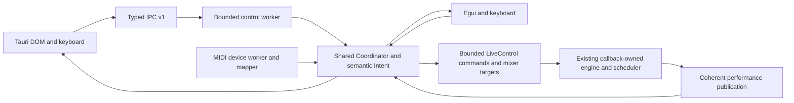

# Architecture overview

DAWJ is a Rust workspace with one audio engine and two frontend executables.
Tauri uses the shared application worker through IPC; egui directly owns the
same Coordinator on its application thread. They do not share an engine between
processes. Running both starts independent sessions, subject to device sharing.

| Crate | Responsibility |
| --- | --- |
| `timebase` | Musical ticks, tempo maps, sample-frame conversion and quantization |
| `parts` | Fixed-slot lifecycle reducer and part identity |
| `event-engine` | Offline and live musical scheduling, periodic rules |
| `audio-backend` | Resident samples, part DSP, mixer, cue routing and CPAL callback |
| `dawj-core` | Coordinator, semantic actions, MIDI, pure timeline projection, IPC and worker |
| `dawj` | Egui application and keyboard/performance surface |
| `dawj-tauri` | Thin Tauri host and HTML/CSS/Canvas performance surface |
| `offline-render` | Deterministic offline WAV fixture |

## Ownership and scheduling

CPAL renders on the audio callback. Prepared resident media, scheduler, voice
cursors, filters and smoothers belong to that engine. Frontends never mutate
those structures or implement duplicate mixing/scheduling.

Tauri's named control worker prepares assets, enumerates/opens/closes output,
services Coordinator/MIDI and produces IPC replies. The separate MIDI worker
owns driver connections and feedback sends. Potentially slow driver calls are
outside the audio callback, but can delay control replies and shutdown joins.
There is no claim that an in-progress OS driver call is cancellable.

All inputs become shared semantic actions. Source tags make held modes and
release/disconnect handling explicit. Absolute MIDI controls use pickup; relative
encoders use the shared mapper. GUI styling never defines action meaning.

## Truth and admission

IPC v1 requests have version/correlation IDs and typed commands. Rust is the
authority; checked generated frontend fixtures reduce schema drift. Worker
admission is bounded at 32 outstanding permits. The frontend serial window and
latest-value map each cap at 24. Releases have an out-of-band epoch latch, so a
full queue cannot make an old momentary press survive focus loss.

Continuous parameters merge into one waiting target per slot, with one in-flight
publication per slot. Fair flushing admits at most four targets per tick and
reserves receipt capacity for discrete actions. Accepted target, pending receipt,
executed lifecycle and diagnostic meter are separate concepts. Playing is always
derived from the coherent engine publication.

Read the [performance-state contract](performance-state.md) and
[engine behavior](engine.md) and [retained decisions](decisions.md) before changing control/state flow. The callback's
frame clock is the musical authority. A late UI command may target a later
boundary; frontend wall clocks cannot backdate already rendered audio.

## Frontend and skin boundaries

Tauri uses plain modules and CSS, without a frontend framework or a web server.
Canvas draws Rust-projected timeline fractions. Refresh and visual interpolation
are observers of time, never event schedulers. A normal idle poll refreshes state;
the release harness documents its own controlled command/poll workload.

Skins are validated JSON, semantic variables, restricted CSS and embedded static
PNG assets. They cannot execute JavaScript or access arbitrary native APIs.
Native reset remains outside user CSS. See [skin authoring](../skins/authoring.md).

Contributions should preserve [realtime guarantees](engine.md), update the state
contract when APIs change, and use the [development checks](../development/README.md).
