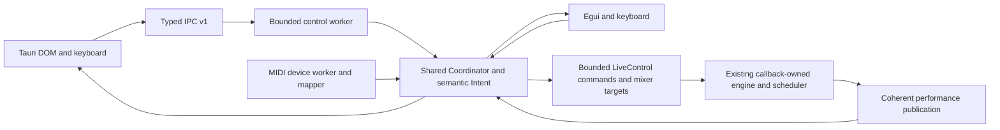

# Architecture overview

DAWJ is a Rust workspace with one audio engine and two frontend executables.
Tauri uses the shared application worker through IPC; egui directly owns the
same Coordinator on its application thread. They do not share an engine between
processes. Running both starts independent sessions, subject to device sharing.

| Crate | Responsibility |
| --- | --- |
| `timebase` | Musical ticks, tempo maps, sample-frame conversion and quantization |
| `parts` | Fixed-slot lifecycle reducer and part identity |
| `event-engine` | Offline and live musical scheduling, periodic rules |
| `audio-backend` | Resident samples, part DSP, mixer, cue routing and CPAL callback |
| `dawj-core` | Coordinator, semantic actions, MIDI, timeline, local sessions, IPC and worker |
| `dawj-egui` | Egui fallback and keyboard/performance surface |
| `dawj` | Default Tauri alpha host and HTML/CSS/Canvas surface |
| `offline-render` | Deterministic offline WAV fixture |

## Ownership and scheduling

CPAL renders on the audio callback. Prepared resident media, scheduler, voice
cursors, filters and smoothers belong to that engine. Frontends never mutate
those structures or implement duplicate mixing/scheduling.

Tauri's named control worker enumerates/opens/closes output, prepares initial assets,
services Coordinator/MIDI and produces IPC replies. The separate MIDI worker
owns driver connections and feedback sends. Potentially slow driver calls are
outside the audio callback, but can delay control replies and shutdown joins.
There is no claim that an in-progress OS driver call is cancellable.

All inputs become shared semantic actions. Source tags make held modes and
release/disconnect handling explicit. Absolute MIDI controls use pickup; relative
encoders use the shared mapper. GUI styling never defines action meaning.

## Truth and admission

IPC v1 requests have version/correlation IDs and typed commands. Rust is the
authority; checked generated frontend fixtures reduce schema drift. Worker
admission is bounded at 32 outstanding permits. The frontend serial window and
latest-value map each cap at 24. Releases have an out-of-band epoch latch, so a
full queue cannot make an old momentary press survive focus loss.

Continuous parameters merge into one waiting target per slot, with one in-flight
publication per slot. Fair flushing admits at most four targets per tick and
reserves receipt capacity for discrete actions. Accepted target, pending receipt,
executed lifecycle and diagnostic meter are separate concepts. Playing is always
derived from the coherent engine publication.

Read the [performance-state contract](performance-state.md) and
[engine behavior](engine.md) and [retained decisions](decisions.md) before changing control/state flow. The callback's
frame clock is the musical authority. A late UI command may target a later
boundary; frontend wall clocks cannot backdate already rendered audio.

## Frontend and skin boundaries

Tauri uses plain modules and CSS, without a frontend framework or a web server.
Canvas draws Rust-projected timeline fractions. Refresh and visual interpolation
are observers of time, never event schedulers. A normal idle poll refreshes state;
the release harness documents its own controlled command/poll workload.

Skins are validated JSON, semantic variables, restricted CSS and embedded static
PNG assets. They cannot execute JavaScript or access arbitrary native APIs.
Native reset remains outside user CSS. See [skin authoring](../skins/authoring.md).

Contributions should preserve [realtime guarantees](engine.md), update the state
contract when APIs change, and use the [development checks](../development/README.md).

## Local content and resident publication

`dawj_core::session` wraps the existing `parts::Part`, playback and timing fields
in versioned JSON metadata, without a second synthesis/pattern/scheduling model.
Its strict typed deserializer and semantic validation check names, identities,
references, timing, loop bounds, parameter ranges, version and document budget.
Save writes/syncs a unique sibling temp file then atomically replaces the destination.
Open resolves references against that document; Save As rebases relative media.

Typed IPC v1 gains an additive `session` command family and workspace view in the
snapshot. These are application configuration and preparation feedback; they
cannot claim audio execution. `available` means a prepared immutable voice exists
for that slot. Lifecycle and timeline continue to use one engine publication.
Initial targets are admitted before device opening so driver delay cannot discard
saved parameters; the UI still waits for fresh publications before performing.

At most one media preparation thread exists per worker. It receives a bounded
candidate document, decodes/resamples WAV off the control/audio/WebView threads,
and returns through a capacity-one channel. Other deck actions and MIDI continue.
Destination quiescence is checked before work and before commit, including
unacknowledged discrete receipts. Failed/stale preparation leaves content intact.
Shutdown drops the receiver; it does not join a potentially stalled file read.
New/Open requires output closed. A single-deck edit requires only affected decks
stopped, with no pending actions or installed periodic rules.

The engine bank is a fixed array of 64 `OnceLock<SampleVoice>` cells shared with
the sole `LiveControl` producer. Producer-only preflight checks rate, duplicate
voice definitions, free cells and the 256 MiB aggregate budget before immutable
publication. The callback only uses nonblocking `get`/indexed reads. No callback
asset decode, file I/O, mutex, allocation, mutable-bank swap or PCM destruction
is added. Replaced versions remain resident until stream/control ownership ends;
exhaustion rejects further installs until output restarts. Names/parameter edits
reuse versions. Changed sample/playback/timing definitions prepare new versions.

Local settings retain independent per-deck shaping and periodic definitions,
even when both reference one composition. Session Open does not resume transport,
pending actions, held modes or saved periodic execution. Saved rules require an
explicit ordinary engine arm command. The native file dialog adapter uses rfd on
a blocking pool; native drop emits only one path/position into the existing local
frontend. CSP and skin execution restrictions remain intact.

See [the user workflow and limits](../user-guide/local-sessions.md). The engine owns fixed-size `parts::pattern::Pattern` definitions and schedules
velocity-bearing sixteenth-note triggers. Live edits activate at the next global
bar, with accepted/pending/executed revisions kept distinct. Four stored pattern
variations per Sound reuse the same pattern submission path; they are not a
second scheduler. The exploratory portable package
schema remains a distinct future design, not the local document schema.

## Tauri workspace and mixer presentation

`workspace.mjs` rearranges existing fixed deck controls around a permanent mixer
and routes menus/palette through shared semantic actions. It holds presentation
layout and offline focus only. Workspace choice is an additive field in the
existing interface preferences; no second content/settings database exists.
Views release momentary modes and never issue transport restarts. Sketch/browse
reuse one browser instance and the same session model. Loaded-material bands and
progress derive from session metadata plus coherent Rust publication. Jam4 adds
actual non-realtime source analysis, without wall-clock musical extrapolation.

Mixer `deck_peaks` are independent pre-fader/pre-crossfader decaying diagnostics,
published once per render block through two atomic words. They are not lifecycle
or execution acknowledgments. Master held peaks, limiter, output trim, cue routing
and existing gain smoothing are unchanged. Three-band deck EQ remains deferred.

Timeline wire zoom reports the actual displayed bar count after the window is
capped to the engine phrase length; it does not label a four-bar phrase as an
eight-bar display merely because the view requested eight.

## Material analysis and sections

`waveform` analyzes read-only decoded canonical PCM during non-realtime preparation.
It stores stereo min/max/RMS pyramids with at most 1024 finest columns and a
96-source bounded LRU (about 6 MiB of bin storage). Loaded source keys are pinned;
PCM is not retained by the cache. Identity includes prepared PCM content, frame
count and rate, so same-path/same-size/same-mtime replacements invalidate on
preparation. Matching content reuses analysis. A playing preview continues to
refer to its immutable resident version until that source is actually replaced.

`visualization` projects source windows, one-shot/loop repetition, velocity
patterns, density and manually authored structure through the shared timebase.
Its optional `EnvelopeSource` capability and optional peak/density fields allow
future providers without adding synth or plugin hosting. Unknown/unavailable
material remains explicit. A current-tempo material preview is not an arrangement
or a promise of future starts; actual source and pattern positions are separate.

The Overview IPC command caps requests at sixteen unique addresses, 1024 requested
columns and 8192 projected columns total. Only the inspected source supplies an
additional full-source envelope. Structure omits projected waveform arrays.
Replies are cached by material revision, style, resolution and detail selection;
unchanged requests can return no geometry. Continuous snapshots carry revision
keys and small live overlays, never PCM or peak arrays. The WebView rejects stale
material replies and caches static Canvas layers; only moving overlays redraw
when the authoritative publication advances.

The non-realtime Coordinator retains definitions by pattern revision (one
confirmed plus up to 32 admitted definitions per slot). Overviews use the executed
definition and label its editable replacement separately until Rust activates it.
Manual sections and per-composition display length/label choices are validated
version-3 local document metadata. Existing content actions/history handle edits,
and versions 1/2 migrate on Open. Analysis caches are excluded from documents.
