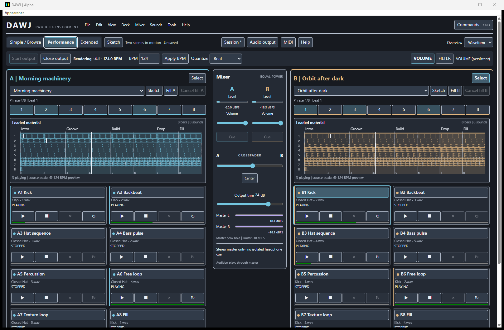
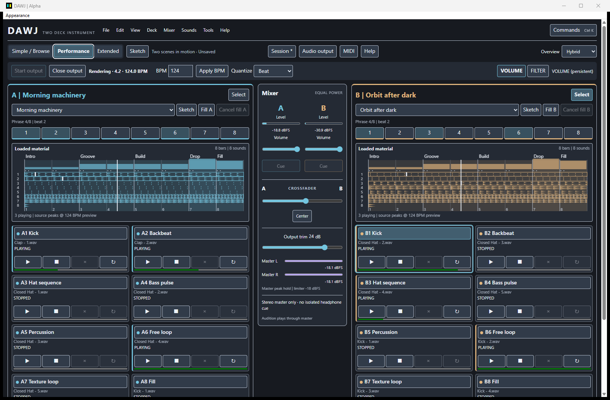

# Musical overviews

DAWJ shows loaded material on both decks before any part is launched. Choose a
style with the **Overview** selector or the View menu/command palette. The choice
survives restart and is independent of the workspace and selected skin.

| Style | What it shows |
| --- | --- |
| Structure (default) | Readable energy/emphasis blocks, rhythmic density, step activity and accents, repeated part lengths and manual section labels. |
| Waveform | Real analyzed stereo min/max peaks projected across the material preview. |
| Hybrid | Section/energy context above a compact waveform for each part. |

These are actual Tauri captures of two authored compositions. See also the
[stopped-material overview](../images/jam4-structure-stopped.png) and
[1024 x 768 Hybrid layout](../images/jam4-hybrid-small.png).

## Read material and execution separately

Loaded but inactive material stays visible in the deck's color. Active parts get
a clear outline; the scene playhead comes from the Rust musical clock. Part-local
positions and sample-source progress remain independent. Queued launches, stops,
retriggers, fills and edits have boundary indicators. Dashed conditional rule
events can be skipped by manual actions. A pending pattern edit is outlined and
labelled separately; it replaces the confirmed material after the engine's bar
boundary, rather than when the edit button is pressed.

Structure's steps and accents come from the actual velocity grid. Density counts
hits rather than inventing notes from sample peaks. Energy estimates use decoded
source audio and step velocities, before part gain/filter, boundary fades, deck
mixing and limiting. They are not master loudness or a measured output waveform.
A silent source draws a real flat envelope; unavailable sources report an error.

The display describes performable material, not an automatic arrangement. A loaded
part is not necessarily sounding. Section labels do not launch, stop or change
volume. Quiet audio is not automatically Intro, and loud audio is not Drop.

## Loops, sample time and musical time

Pattern lengths are 1, 2 or 4 bars, with their actual repetitions shown across the
composition's display length. Pattern clocks and live positions follow the engine
through tempo changes and retriggers.

Sample loops use their trimmed source-frame region at the engine's native **1x**
playback speed. Their projected repetition length uses the current tempo for
musical context and is not rounded to bars. A 0.25-second loop remains 0.25 seconds
when BPM changes; its apparent musical length changes. Nominal beat metadata never
stretches the waveform or synchronizes a free-running sample. A one-shot has one
reference trigger in the material preview and is not turned into a loop. Actual
future triggers come from queued actions/rules, not these preview reference starts.

Extended shows each part's duration, repetition/pattern information and preview.
The progress indicator follows actual pattern phase or source position. In Sketch,
the **Source / region** view shows the whole analyzed source, dimmed trim/loop
exclusions and the actual source cursor. Stereo channels remain separate. Region
positions use prepared 48 kHz frames; original file-rate metadata remains in the
sound browser. Long one-shots can outlast a scene display; source duration and the
whole-source inspector retain that distinction.

## Author musical sections in Sketch

1. Open the composition's **Sketch** view and find **Musical sections**.
2. Set the composition display length (1-64 bars) and **Apply length / labels**.
   This changes the overview cycle, not the engine's 4/8-bar quantization phrase.
3. Choose Intro, Groove, Build, Drop, Breakdown, Fill, Outro or a custom label.
   Set its bar and beat; quarter-beat increments are sixteenth-note positions.
4. Optionally choose a visual **Emphasis**. Source energy is the default; explicit
   Minimal/Quiet/Medium/Strong/Intense values supply a manually authored visual contour.
   This annotation changes the display, not the audio.
5. Press **Add section**. Select an existing label to rename or reposition it with
   **Update selected**, or use **Remove selected**. Undo/Redo uses the existing
   content history. Labels can be hidden per composition without deleting them.
6. Save the session. Labels, positions, emphasis and display choices reopen with
   the composition; no external configuration file is required.

Explicit labels always retain their authored meaning regardless of measured
energy or density. Sections need unique positions inside the display length;
move out-of-range labels before shortening it. At dense zoom levels, source
min/max bins and boundary summaries favor readability over individual samples.

## Preparation and limits

Analysis reads decoded audio outside the realtime callback. DAWJ reuses bounded
multiresolution RAM envelopes by prepared content identity, including when parts
share a sample. Reimport, Open and Start check the decoded content again; changing
a file without changing its name, size or timestamp does not reuse a different
decoded source's preview. Playing sources keep their already prepared version
until explicitly replaced. There is no live filesystem watcher or callback decode.

Preview resolution follows canvas width and display scaling. Peak bins
conservatively retain transients; their edges may include nearby frames. Static
geometry crosses IPC only when material, style or the view's resolution changes.
Only the inspected source sends an additional whole-source envelope. Playback
positions come from coherent Rust snapshots; stale/delayed UI updates do not
create a new musical clock.

Analysis is rebuilt after reopening and is not stored as essential project data.
Local document version 3 retains manual structure; older version 1/2 sessions
migrate on Open. WAV preparation, MIDI mappings, skins and the egui fallback
continue to use their existing shared systems. Explicit demo voices do not have
an analyzed local-source preview; the visualization workflow uses authored
compositions and actual assigned samples.

This milestone does not perform automatic section/drop detection, beat-grid
analysis, time stretching, synth/VST hosting, full-song DJ playback or recording.
