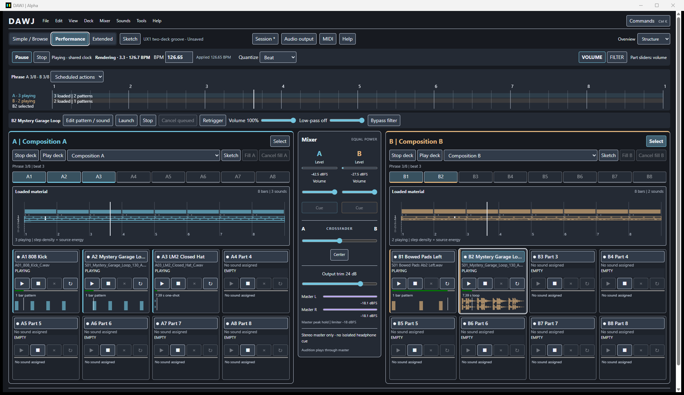

# Performing with DAWJ

DAWJ keeps Deck A on the left, Deck B on the right and the mixer between them.
Create your own material using [local sessions and Sketch](local-sessions.md),
then launch its parts. Audio initializes automatically on the configured or
system-default endpoint; failures open recovery settings. The explicit Session demo is optional.

## Choose a workspace

| Workspace | Use |
| --- | --- |
| Simple / Browse | Compact decks and a large sound browser for preparing the next part/composition. |
| Performance | Eight fixed part slots on each deck, launch/stop/cancel/retrigger, fills and a compact phrase view. |
| Extended | Part gain/filter controls, full phrase view, variations and periodic scheduling details. |
| Sketch | Composition naming, sound assignment, velocity patterns, sample regions and metadata, beside the same mixer. |

The three workspace buttons and each deck's Sketch button are always discoverable.
Switching views does not restart output, change part identity or schedule music.
The workspace preference survives restart through existing interface settings.
The mixer stays in the center. The default window targets 1600x900 and clamps
to the monitor work area. The primary reference is 1920x1080; 1280x800 remains
usable with vertical scrolling. Controls also support display scaling.

[Sketch and graphical trimming](../images/ux1-sketch.png) ·
[Offline help](../images/ux1-help.png) ·
[Source/license inspection](../images/ux1-source.png)

## Musical transport

See [the canonical transport guide](../help/perform.md) for exact semantics.
Play resumes the shared clock without launching all parts. Pause holds cursors,
patterns and deadlines while the audio device remains open. Stop clears both
decks' execution/rules and holds the current clock position. Deck Stop clears only
one deck; Deck Play launches its loaded stopped parts at the selected grid.
Manual Launch/Retrigger resumes the shared clock through the same Rust path for
mouse, keyboard and MIDI. Independent deck pause and timeline seeking are deferred.

## Launch and shape parts

Click a part name to focus it without launching; double-click toggles it. Drag a
browser sound onto a stopped part to assign it. Launch, Stop, Cancel and Retrigger
have their own buttons. The label distinguishes a stopped or unavailable sound
from a queued launch, stop or retrigger. Boundary labels use actual engine bar/beat
positions. Loaded-material indicators remain visible even when nothing is queued;
they are metadata/activity summaries, not fabricated waveforms or analyzed sections.
Thumbnails show real source-region peaks or velocity-bearing pattern triggers.
Progress follows actual pattern phase or the source cursor mapped through its
trim/loop region. Paused parts are labelled separately using engine transport.
Pending pattern changes have a dashed border and a separate boundary message.

The focused part's explicit Volume and Low-pass controls remain accessible,
with deck/slot identity and actual applied values. They also work in Sketch.
VOLUME/FILTER chooses what the per-part contextual sliders mean in Extended.
Changing that mode never changes sound by itself. Filters are genuine smoothed
part low-pass filters. Deck three-band EQ is a remaining engine dependency and
is not presented as a working control.

Fill A/B addresses fixed slot 8. Assign a one-shot fill or pattern to that slot;
there is no automatic fill generator. In Extended, periodic rules can schedule
sample parts on beats, bars or phrase bars. Remove a pattern before arming a rule
on its slot. Conditional projected recurrences are marked `~`, and may be skipped
because manual actions take precedence. Removing a rule does not stop its source.

## Mix from the center

Each channel has a real pre-fader/pre-crossfader decaying peak meter, deck Volume,
and Cue selection. These deck meters show source level even when a channel is
faded out. Cue is post deck volume and pre-crossfader. Cue is unavailable on stereo
hardware; DAWJ never simulates headphone isolation. Four-channel logical routing
uses master 1-2 and cue 3-4; physical isolation needs hardware verification.

The equal-power crossfader moves from A-only through both decks to B-only. Center
returns to the middle. Deck volume and crossfader targets use engine smoothing.
Output trim is pre-limiter makeup gain on both logical buses, not another deck
volume. Master L/R meters are lifetime peak holds after the existing limiter,
whose ceiling remains 0.125 (about -18 dBFS). They are not loudness/RMS meters.
Audition explicitly uses the shared master independently of the deck crossfader.

Drag BPM to adjust it, hold Shift for fine changes, or double-click to type and
press Enter. The applied readout is authoritative. Changes use the existing musical
quantization and leave sample speed unchanged. Closing the audio device in Settings
destroys the stream; reopening creates a fresh clock. Source Listen bypasses part
shaping, so use part playback when checking volume and filter response.

## Navigation and shortcuts

File / Session, Edit, View, Deck, Mixer, Sounds / Library, Tools / Settings and Help
organize application actions. **Ctrl+K** opens a searchable command palette; type,
press Down to move into results, use arrow keys and Enter to execute. Disabled
actions reflect the current session/engine availability. Audio, MIDI and skins
remain available through Tools and the top bar.

| Keys | Action |
| --- | --- |
| Ctrl+N / Ctrl+O / Ctrl+S / Ctrl+Shift+S | New / Open / Save / Save As |
| Ctrl+1 / Ctrl+2 / Ctrl+3 | Browse / Performance / Extended |
| Ctrl+E | Sketch / Perform |
| Ctrl+Z / Ctrl+Shift+Z or Ctrl+Y | Content Undo / Redo (typing retains native text undo) |
| A / B, then 1-8 | Select deck and part |
| Space / X / Esc / R | Toggle / Stop / Cancel queued / Retrigger |
| V / F | Persistent gain / filter mode |
| Shift+V / Shift+F | Hold temporary mode; release/focus loss restores persistent mode |
| F1 / F2 / F3 / F4 | Immediate / Beat / Bar / Phrase quantization |
| Left / Right | Move crossfader by 5%; key repeat supported |
| Q / W | Cue A / B where available |
| H | Performance help |

Inputs keep typing keys; leave text focus before playing shortcuts. Focus loss,
menus and view changes release held modes. MIDI retains the same fixed part
addresses and shared action mappings; see [controllers](controllers.md).
Skin/accessibility choices retain text scale, enhanced contrast and reduced
motion. Native Appearance > Restore default interface and Ctrl+Alt+Shift+R remain
available outside user CSS. Egui remains a runnable fallback; this new authoring
and workspace layout is specific to Tauri.

The screenshots and scripted Windows native checks show functional operation,
not physical cue isolation, real-controller validation, latency certification or
human usability testing.

## Musical overviews

Use the **Overview** selector or View commands for Structure, Waveform and Hybrid.
Both decks show material before launching parts. Structure is the default; the
choice survives restart independently of the workspace and skin. Section labels
come from manual Sketch metadata. See the [visualization guide](musical-overview.md)
for source energy, loop timing, pending edits and source inspection.
